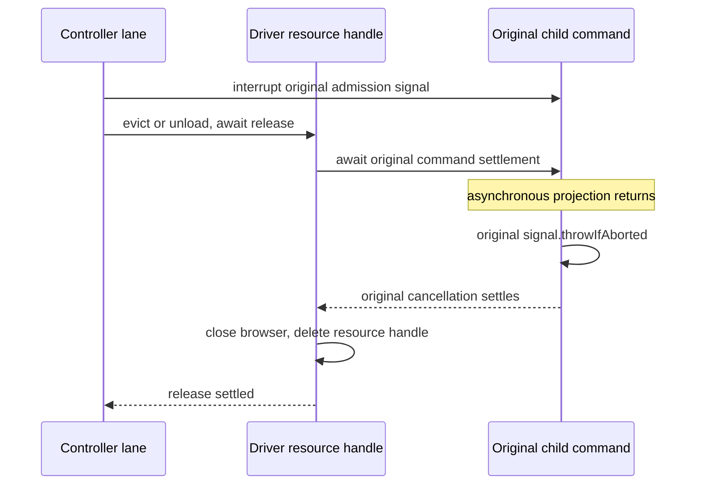

# Task3b review P1：中断 child 的普通释放不能形成 lane 等待环

独立 BOUNDARY2 探针纠正原检查的假阴性：必须先证明child成功执行TodoRead且到达第二次beforeModel，
再让该边界停在派生投影IO；此时root中断child并以maxLoadedChildren1生成替代child。普通eviction
在controller lane内release→等待旧command，而旧command等投影结束后试图tree.deliver→等待同一lane。
显式unload具有相同环。dispose的同步closingRequested并不覆盖普通释放。

原runningCommands资源表中的同一handle现在同时持有原completion与原admission signal；不另建generation、
状态或身份owner。beforeModel在awaitProjection之后、tree.deliver同步enqueue之前检查signal，中间无await。
root由外部turn拥有且没有该child command handle，普通root行为保持原合同。followup已有lane外drain，
不会在旧handle退出前启动新轮。release仍真实drain再关资源，cleanupPending/原cause链保留，无新timeout。

先写合同及auto eviction/explicit unload两项实际RED，均断言blocked vs settled。GREEN为runtime目录+
residency/background/shutdown9文件115/115、controller54/54；根原始独立probe1/1也通过。
测试gate覆盖第二边界、release已开始且资源未提前关；后续replacement等真实provider请求，断言session
不同，不能把spawn ACK当模型已启动。被中断旧child没有第二次provider IO。core noEmit/lint/架构0通过。

整批Task3b仍须独立spec复审与quality；本修复没有提前开启Task4或宣称全客户端验收完成。
