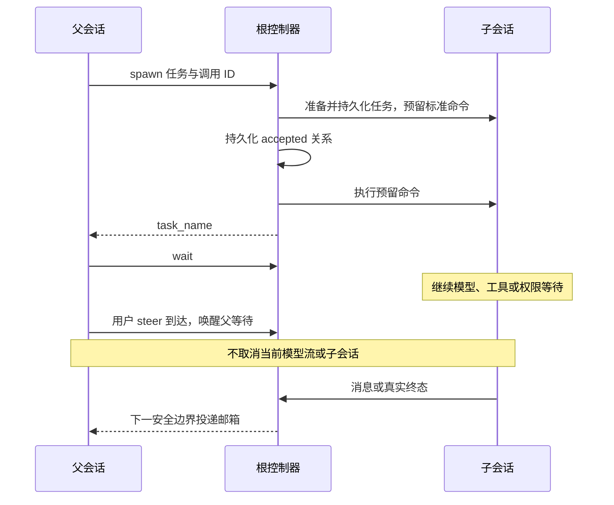

# 子智能体协作六工具

## 二开合同：codex-collaboration

2026-11-02 决定全面替换旧子代理工具。`Agent`、`Task`、`SendMessage`、
`RespondToCoordinator` 不再是调用入口，不保留执行别名、搜索映射或旧协议适配。
当前实施进度与实际验证边界见[实施记录](../../../../../../docs/features/codex-collaboration/implementation.md)；
本文规定目标行为，不代表所有阶段已经验收完成。

完整合同按职责分别维护：

- [设计与验收](../../../../../../docs/features/codex-collaboration/design.md)：产品语义、所有者和恢复边界。
- [六工具合同](../../../../../../docs/features/codex-collaboration/tools-contract.md)：严格输入输出、角色和配置。
- [控制器合同](../../../../../../docs/features/codex-collaboration/controller-contract.md)：身份树、邮箱、名额、generation 和清理。
- [真实运行链](../../../../../../docs/features/codex-collaboration/runtime-integration.md)：持久化、模型继承和标准命令准入。
- [客户端验收](../../../../../../docs/features/codex-collaboration/client-acceptance.md)：子会话下钻、冷恢复和两种交付语义。

## 使用与结果

| 工具 | 用途 | 成功结果 |
| --- | --- | --- |
| `spawn_agent` | 以任务名和正文创建可寻址子智能体 | `{task_name}`，表示接受任务 |
| `send_message` | 投递消息；目标空闲时只排邮箱 | 空模型文本 |
| `followup_task` | 向已有子智能体投递任务，并在空闲时启动新轮次 | 空模型文本 |
| `interrupt_agent` | 显式中断指定子智能体当前轮次 | `{previous_status}` |
| `list_agents` | 查看已加载智能体的身份路径及状态，可按路径前缀过滤 | `{agents:[{agent_name,agent_status}]}` |
| `wait_agent` | 等待消息、终态或超时 | `{message,timed_out}` |

只有 spawn 新建子智能体。创建任务的工具完成不代表子任务完成；真正终态来自子智能体生命周期。
后续任务使用已有路径，保留同一会话和历史。错误与中断不销毁身份，也不要求重新 spawn。
父子之间用同一消息工具交流，不区分旧式 main-only 发信和 child-only 回信工具。

target 可使用同一身份树中的智能体 ID、相对任务路径或规范绝对路径；不能指定或覆盖内部 caller、
session ID、trace 或运行 generation。跨树目标被拒绝。
工具沿既有 registry、权限、hooks、执行器和结果预算执行；ToolSearch 开启时六工具仍直接可调用。
`TaskOutput` 与 `TaskStop` 只处理非子代理后台任务；原生子代理 Stop 发送显式 interrupt。

## 所有者与时序

根控制器拥有整棵身份树、accepted 调用、邮箱、执行句柄与名额；子会话使用绑定自身身份的同一控制器端口。
版本化 root session entry 是持久权威；registry、生命周期和 ToolPart 身份均为派生事实。
正常父轮结束不会关闭子智能体。宿主关闭显式等待整树清理，普通 Stop 只影响所选会话。

## 上下文、模型与权限

`fork_turns` 默认为 `all`，继承创建时父会话有效历史和模型选择；完整工具调用与结果必须配对，
未完成的当前工具批次不能被复制成悬空调用或再次执行。`none` 使用独立历史，并可按严格合同覆盖模型。
两种模式都使用子角色及实际可用工具提示，不继承活动 signal、权限请求或一次性授权句柄。

profile、skills、memory、AGENTS 与 MCP 继续使用既有装配规则。未知 profile 或模型返回带请求值及
可用集合的上下文错误。子会话首次接受时保存模型选择；后续任务和冷恢复使用子会话保存的选择。
未读消息持久化并取得 ACK 后才出箱；provider 唯一投影边界把协作来源转为 assistant 信封，
不能把其他智能体正文当作用户授权。

根配置为 `subagents.delegationMode/maxTotalAgents/maxDepth/maxLoadedChildren`；默认总名额 4
含根、子深度 1、驻留 child 3。嵌套子智能体共享同一配额，不各自创建独立调度器。
完整默认值、越界行为、等待上限与取消规则以链接的严格合同为准。

## 验证边界

控制器假 driver 测试、真实 runtime 测试、独立 HTTP 协议进程测试和桌面/手机 GUI 验收分别记录。
旧工具时代的测试产物只证明当时行为，不能作为六工具运行链的验收结果。
