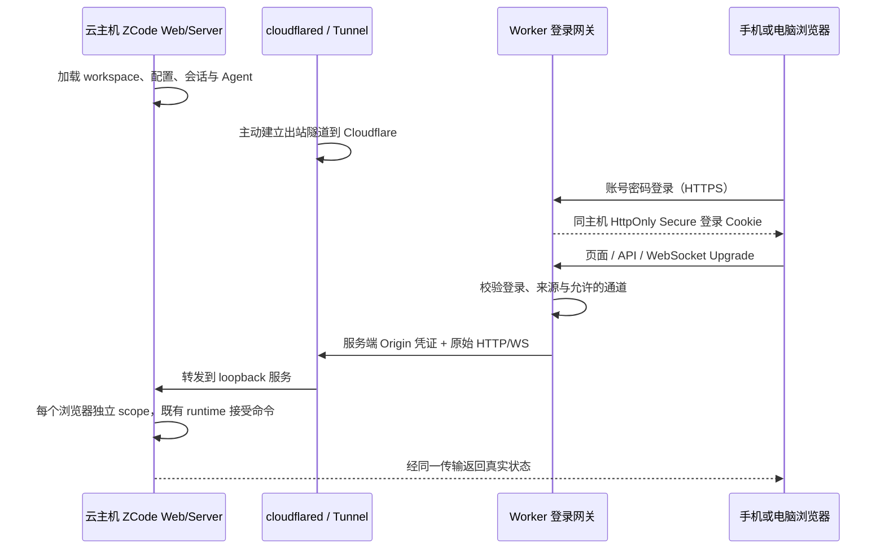

# 云端 ZCode 浏览器访问最小版本

状态：方案待确认，尚未实现或部署。基线：2026-11-03，canary `6b007f78`。

## 用户目标与边界

在 Linux 云主机运行 ZCode，主动连接 Cloudflare；手机和电脑浏览器访问统一入口，以部署时设置的一套账号密码登录。任务、文件、模型配置与 Agent 均由云主机持有。Cloudflare 承担认证与传输。

第一阶段交付：登录、访问现有 Web 界面、读取项目与历史、创建任务、发送消息、接收流式结果、处理权限请求，以及多个浏览器的独立连接。浏览器刷新后从云端恢复真实历史。

暂缓：电脑离线时的持久离线阅读、WebDAV 替换、云端配置备份、原生手机应用、桌面 Electron Relay V2 多对多改造、自动发现所有云实例。早先的多客户端目标保留为后续范围；MVP 先验收一个云实例和多个浏览器，不能把它宣称为已完成多实例控制台。

## 当前源码事实

- `README.md` 与 `specs/zcode-unified-distribution.md`：统一 Node 运行包支持 `zcode --web`，同时托管现有 Web 静态资源、HTTP/WebSocket 服务及 Agent；不需要 Electron。
- `packages/server/src/http.ts`：普通 `/ws` 固定创建 `web-remote-replayable` 的 terminal-client scope，每个连接有独立 connectionId。`/ws/host` 与 `/api/rpc-host-capability` 属于受信 Host 通道，浏览器网关不得开放。
- `packages/web/src/main.tsx`：普通 Web 从同源 `/api/server-info` 获取默认工作区，再连接同源 `/ws`。它与 `/remote/v4` 的桌面配对入口不同。
- `packages/server/src/entry-http.ts`：已有 loopback 监听、静态目录、workspace 和 Bearer token 配置。
- 现有桌面 Relay V2 需要 Electron main 的设备注册、手机 owner 与 attachment 调度，不能将它直接当作 headless Linux 云服务的现成连接器。
- 多 WebSocket scope 的源码结构支持复用，但多浏览器同任务的实际交互、手机窄屏可用性仍需验收，不能仅凭源码宣布通过。

## 方案比较与待确认项

| 方案 | 接入方式 | 改动与维护 | 状态 |
| --- | --- | --- | --- |
| A：Worker + Cloudflare Tunnel | 云端 cloudflared 出站连接；Worker 校验账号密码后代理现有 Web HTTP/WS | 不改 Agent 或桌面 Relay；新增独立网关包与部署配置；需要配置 Tunnel | 推荐，待用户确认是否接受 cloudflared |
| B：Worker/Durable Objects + 专用连接器 | ZCode 外围连接器主动连接 DO，中转浏览器请求 | 需实现 HTTP/WS 多路复用、流控、连接路由、取消及重连；变更面更大 | 用户若只接受 Worker/DO，再单独定接口 |
| C：Worker 连接公网 Origin | Worker 直接访问已暴露的 ZCode 服务 | 部署简单，但不符合用户期望的云主机主动连接方式 | 本期排除 |

方案 A 使用 Cloudflare 已有 Tunnel 传输，不额外创建业务队列或会话副本。官方资料：

- <https://developers.cloudflare.com/tunnel/>
- <https://developers.cloudflare.com/network/websockets/>
- <https://developers.cloudflare.com/workers/runtime-apis/bindings/rate-limit/>

## 推荐方案的状态归属与事件顺序

| 状态 | 唯一所有者 | 持久化 |
| --- | --- | --- |
| 固定账号与密码、会话签名配置 | Worker 部署配置与 Secrets | 不进入前端资源、源码或日志 |
| 浏览器登录 | 网关签发，浏览器 Cookie 承载 | 有效期与域名绑定；不得借用官方 OAuth/模型账号 |
| HTTP/WS 连接 | Tunnel 与现有 Server scope | 不保存业务消息；断线回到现有服务恢复路径 |
| 任务、权限、已接受输入、执行顺序 | 云端既有 Host/CLI/runtime | 云主机原有数据目录 |
| 浏览器草稿与选中态 | 各浏览器 | 沿用现有行为，不将一端导航广播给另一端 |

必须满足：

1. 云主机 ZCode 绑定 loopback；隧道 Origin 同样需要服务端凭证，不能绕过 Worker 登录访问 RPC。
2. 网关仅转发普通 Web 需要的通道；禁止浏览器升级到 trusted-host，剥离来源伪造的 Host capability、Origin 凭证和代理认证头。
3. WebSocket 校验同源；登录与退出的修改请求校验来源；密码不写 URL、二维码或 localStorage。
4. 未登录的 HTML 导向登录页；未登录的 API/WS 返回明确未授权，不能把登录 HTML 误当 RPC 响应。
5. 不缓存授权后的 API 与 HTML；HTTP 与 WebSocket 均经过同一认证边界。
6. 网关不自行重放用户命令、不自动重复提交权限决定。多个浏览器对同一任务的冲突由既有云端 owner 裁决。
7. 退出删除浏览器凭据；密码/会话密钥轮换使旧 HTTP/Upgrade 登录失效。已经建立的 WS 是否即时撤销必须明确，不默认宣称能被无状态 Cookie 方案立刻关闭。
8. Origin 不可达与密码错误分别展示；登录成功不意味着云端 ZCode 健康。不得将 502 伪装为 401。

## 影响分析

| 用户场景 / UI Surface | 入口与显示所有者 | 校验与提交 | 权威来源 | 边界 |
| --- | --- | --- | --- | --- |
| 登录 | 独立 Worker 登录页 | 固定账号密码与限速 → Cookie | Worker Secrets | 不恢复官方账号、权益或云模型配置 |
| 浏览工作区与会话 | 原有 Web Root | 原有 services 与 RPC | 云端 Server / runtime | 不新建手机 Agent |
| 多浏览器控制 | 每浏览器独立连接与草稿 | 原有命令准入与权限对账 | 云端同一任务 owner | 一端断线不得清理其他 scope |
| 云端离线 | 网关明确服务不可达 | 禁止伪造成功或自动重复提交 | Origin 连通性 | 离线历史阅读暂缓 |

共享/差异：复用普通 Web 的聊天、工具和协议；登录是新的独立 surface。桌面 continuous 与手机 replayable 仍由 Server 既有可信装配区分。

必查上游/下游：网关认证 → Server token（must-inspect）；WS 转发 → 独立 scope 与清理（must-inspect）；普通 Web Root → 手机窄屏（must-inspect）；云端模型提供商与运行包（deployment prerequisite）；WebDAV/官方设备同步（invariant-only）。

代码证据：以 `http.ts:createHttpServer/setupChannelServer`、`main.tsx:resolveWebBootstrap/bootstrapWebApp`、`scripts/zcode-distribution/runner.mjs:serve` 为起点，直接调用深度 1–2；本次用源码搜索核实，未运行 codegraph。`server` 模块当前 legacy，架构检查不能证明其运行语义；新增网关包必须登记 managed。语义图尚无 cloud-web-access 节点，方案确认后登记；不把待定 Tunnel 路线写成已确认关系。

## 验收场景（实现前定义）

| ID | 操作 | 必须观察到的结果 | 证据层 |
| --- | --- | --- | --- |
| CWA01 | 未登录访问 HTML/API/WS，或直接访问 Origin RPC | 登录门禁/401；Origin 凭证未泄露 | Worker 契约与真实隧道 |
| CWA02 | 正确/错误密码、会话过期、跨域提交、修改后的 Cookie | 成功进入；不同拒绝原因准确；限速实际生效 | Worker runtime / 浏览器 |
| CWA03 | 经网关加载真实 Web，打开项目，发送一轮固定回复请求 | HTML/资源/API/WS 均成功；真实模型请求与回复 | 隔离数据、回放模型、浏览器 |
| CWA04 | 两浏览器连接同一云实例，各自选任务；关闭其中一个 | 导航独立；另一个继续接收并可发送；任务未取消 | 双 context 浏览器 |
| CWA05 | 手机 390px 与桌面宽屏登录并处理一项权限请求 | 可见、可操作、无横向遮挡；一次决定生效 | 浏览器截图与运行证据 |
| CWA06 | 云端连接中断后刷新或重连 | 明确离线；服务恢复后读取真实历史；无重复发送 | 网络故障注入与运行证据 |
| CWA07 | 请求受信 Host 端点及伪造 capability 头 | 网关拒绝；普通 Web 不升权 | 协议契约 |

未定义：目标主机/域名/运行包来源；是否接受方案 A；首版已建立连接的撤销策略。必须先完成该选择，再写依赖传输方案的产品代码。
