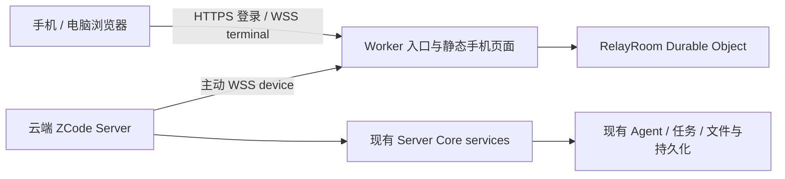

# 自建 Cloudflare Relay 与 ZCode Server 接入设计

版本：2.2，2026-11-04；功能 id：`cloud-web-access`。

本稿取代此前多对多、离线只读与 Tunnel 草案。用户明确要求：本期保留官方连接替换和离线页面行为，只做对应 Relay、Server 连接层与 `zcode server` 命令组。

配套文档：[命令行规格](cli.md)、[协议设计](protocol.md)、[验收矩阵](acceptance.md)、[实施记录](implementation.md)、[部署与运行](deployment.md)、[影响分析](impact.md)。

项目导航、会话恢复、宿主能力和页面版本遵循[远控宿主合同](host-contract.md)。

## 1. 本期目标

用户可以在 Linux 云主机运行 ZCode Server，也可以让 ZCode Desktop 连接同一个自建 Relay。两类客户端都主动连接 Relay，手机或电脑浏览器登录同一固定账号密码后访问对应设备上的项目、任务和 Agent。

Cloudflare 接受两端出站 WSS，负责登录、设备、一次性票据、配对、心跳及透明转发。云端无需开放 ZCode 公网端口，也不需要 Cloudflare Tunnel/cloudflared。

## 2. 已确认范围

| 能力                         | 本期决定                                                         |
| ---------------------------- | ---------------------------------------------------------------- |
| 单租户固定账号密码           | 保留用户既定要求；不做注册、组织与多角色管理                     |
| Worker 后端                  | Worker + Durable Objects，附带手机网页静态资源                   |
| Server 主动连接 Relay        | 本期核心，复用现有 Core/services/Agent                           |
| 同一客户端多个手机           | 按官方：同 SID 同角色只有一个当前 owner，新连接替换旧连接        |
| 多个 Server 设备登记         | 沿用官方设备目录；不同 SID 的配对彼此隔离，不做新的多对多协议    |
| Server 离线后手机体验        | 按官方：现有等待/重连/离线失败页规则，不新增离线只读入口         |
| 手机缓存                     | 沿用现有实现；不新增 IndexedDB、app shell 离线启动或缓存同步策略 |
| Server 管理                  | `connect`、`up [-d]`、`down`、`logs [-f]`                        |
| WebDAV、官方设备配置同步     | 保持现状，不修改、不移除                                         |
| ZCode Desktop 接入自建 Relay | 复用现有桌面远控连接与 attachment，不新增第二套运行时            |

此前讨论的多对多与离线阅读从本期删除，不再作为 P1/P2 必交付阶段；将来用户重新提出时另行设计。

## 3. 架构与状态归属



同一 Cloudflare 部署允许多个独立 device SID；每 SID 仅一个 device owner 和一个 terminal owner。RelayRoom 是单租户连接集合的唯一协调者。它保存认证/设备/连接元数据，不保存 task、workspace、snapshot、队列或转发正文。

Server 连接器由既有 Core 组合根装配，不创建第二份 `createServerHostServices`、Host 或 Agent。手机 attachment 按现有 replayable 边界接入原服务，同一任务继续由原 runtime/CommandInbox 接受命令。

Desktop Main 继续作为桌面远控连接、设备身份和 attachment 调度的唯一 owner。Renderer 只持有尚未提交的配置表单和连接状态投影；密码不进入 Renderer 持久化。配置切换只更换 Relay 地址和登录身份，不改变任务、队列、快照或 workspace 的所有权。

| 状态                           | 唯一 owner                          | 持久化/缓存                                            |
| ------------------------------ | ----------------------------------- | ------------------------------------------------------ |
| 固定账号、密码校验、登录凭据   | Relay 认证组件                      | 安全密码校验信息与可撤销会话元数据                     |
| 设备记录、票据、配对 owner     | RelayRoom                           | DO 元数据；活跃 socket attachment                      |
| 自建连接地址与凭据引用         | Server 配置端口                     | 对应 server-root 下的受限配置/凭据文件                 |
| Desktop Relay 配置与会话       | Desktop Main                        | 非敏感设置与安全凭据存储                               |
| Supervisor/Core 生命周期与锁   | 既有 Server Supervisor              | canonical server-root、原 control endpoint、原状态记录 |
| 手机 bridge 与订阅             | Server terminal attachment          | 连接期 scope；不另存权威任务数据                       |
| 项目、聊天、任务队列、权限结果 | 既有 Core/CLI/runtime               | 云主机已有数据库与文件                                 |
| 日志                           | 既有日志设施及新增最小生命周期 sink | 同一服务实例的持久日志，前台与 logs 都读取这一事实流   |

## 4. 与当前官方代码的关系

- `packages/zcode-server-cli` 是本期执行宿主；其 Core 已持有服务与 Agent，普通 `/ws` 已有 terminal-client/replayable scope。
- 官方桌面 Relay 客户端位于 Electron main；它除了建立 WS，还负责 bootstrap、项目列表、workspace bridge 和平台请求。headless 接入需补这些宿主适配，不能只把一个 WS URL 改为 Relay。
- 浏览器项目向导里的“此电脑”表示当前 attachment 所属 Server。Server 将 `local` 路由到自己的 owner host，按该机 home、目录和项目存储执行，不再要求浏览器知道内部 `remote:server:*` 身份。
- Source Server local bridge 不声明桌面专用的 `window-controller`；客户端在 RPC 清单到达前不创建该可选通道代理，不向未提供的服务发送请求。
- shared 的 Relay V2 类型、HTTP 响应、心跳以及 raw RPC 分片/CRC/ACK/重放机制可以复用。
- 本期保持官方 V2 外层格式与单 owner 行为，不新增 channelId 多路外壳、不新增 Fork Relay v1 数据协议。
- 账号密码登录是自建的新增入口；替换官方 OAuth 的必要适配独立放在 fork 入口，不伪造 Z.AI/BigModel 模型业务令牌。
- Source Server 普通 `/ws` 与 headless connector 只开放已审阅的手机 bootstrap/bridge/RPC 能力；不把完整 ServiceCollection 或 Electron handler 直接暴露给浏览器。
- `packages/server`/`zcode --web` 是另外的 Web HTTP 宿主，本期不再起它与 Source Server 并跑，不让两个服务争用同一数据目录。

## 5. 使用流程

下列产品命令已经接入当前源码入口并映射到既有生命周期。正式发行包分发仍需单独验收；精确语义见 [cli.md](cli.md)。

```text
zcode server connect
zcode server logout
zcode server up
zcode server up -d
zcode server down
zcode server logs
zcode server logs -f
```

1. 部署者部署 Cloudflare Worker/DO/手机页面，设置一套固定账号密码。
2. 云主机执行 connect，使用 TUI 向导或参数提供服务 URL、用户名和密码；先校验登录，成功才原子保存配置，失败保留原配置。
3. 执行 up 启动 Core 和连接器；收到 Relay 的合法 auth_ack（即使 waiting、尚无手机）即建立远控服务就绪事实。
4. 手机打开自建服务页面，使用相同账号密码登录，扫码或从设备列表选择在线 Server。
5. 由现有手机页面完成 bootstrap、选项目、聊天和权限处理；任务与文件均在云主机。
6. logs 读取同一实例的持久日志；down 显式停止整个 Server，保留配置、凭据和业务数据。

logout 删除 Server 的本地 Relay 会话和连接配置。运行中的 Server 必须先完整停止，避免内存中的已认证连接继续存活；停止失败时不得删除凭证。命令不删除项目、日志、模型配置、历史任务或已安装版本，重复执行保持成功。

Desktop 用户从项目侧栏底部打开“移动端远程控制”。首次使用时输入 Relay 地址、账号和密码；登录成功后在同一弹层展示自建网页的二维码与链接。密码仅用于本次登录，保存的会话不随时间过期；只有 Relay 轮换 `AUTH_EPOCH` 或用户重新登录才会使旧会话失效。用户可以在弹层内更换 Relay 或账号。

Server 模型配置在云主机预先完成；首次远控不自动要求官方账号、不把账号密码当模型 API Key。缺少模型时展示真实配置错误。

## 6. 官方配对与离线行为保持

同一个 SID 上，第二台手机接入会替换第一台；旧连接收到 KICKED 并关闭。手机端既有 KICKED 有界重试策略不修改：首次可延迟恢复、短窗口内重复被替换后停止并提示冲突。因此可能发生一次反向接管，不能承诺新手机永远立即稳定占有。

不同 SID 互不转发。设备 owner 更替、terminal owner 更替与 socket close 必须校验当前 owner 引用，旧 close 不得删除新连接。重新注册可能产生新 SID，沿用官方持久身份/重新注册规则，不擅自用 sourceServerId 替代 wire SID。

Server 离线时沿用官方的 waiting、reconnecting、DEVICE_OFFLINE、超时和失败页面。短暂挂起/恢复中现有画面或草稿是否保留，服从现有 owner 路径；不新增“刷新后仍可看离线历史”的保证。

官方手机小快照缓存仍是现有 ETag/传输优化，不升级为本期的离线数据库；不调整容量、退出清理或缓存 key。

## 7. Server attachment 适配

连接器通过公开的宿主端口请求：读取 bootstrap/capabilities、列出或打开工作区、建立/释放 terminal attachment、转发必要平台操作。Core 提供端口实现，连接器不引用 Repo 或 Core 私有类。

每个当前 terminal 对应独立 connectionId、bridge generation 与 scope。被替换/断线时先撤销新请求与在途 open，再结束 RPC、订阅及短期 PTY。只关闭手机 attachment 不停止已经接受的任务；down 才是显式停止 Server 的生命周期操作。

workspaceIdentity 用于身份、workspacePath 用于实际操作；两者按现有工具传递，保留 remoteSessionId 与 stale run 防护。RPC delivery 固定 web-remote-replayable，不允许手机选择 desktop-continuous/trusted-host。

headless 不支持的 Electron 原生窗口、文件对话框等 capability 明确缺席；UI 使用现有禁用/unsupported 反馈，不挂一个永不返回的平台通道。

## 8. Cloudflare 后端

一个 Worker 提供手机静态页面、单租户密码认证及 V2 HTTP/WS 入口；一个 tenant-scoped RelayRoom DO 串行持有设备、一次性 token 与 `(SID, role)` owner。

使用 DO WebSocket Hibernation API。唤醒后从 DO 存储与 socket attachments 恢复连接身份，不能相信 Worker 全局变量。持久记录只包含认证/设备元数据；每片业务 data 直接送另一角色，不落盘、不解析 RPC 内部任务内容。

票据单次消费必须原子化。角色从票据派生，不能由 auth_init 自述升级。在线、waiting/matched、设备归属、同角色替换、断线通知与 V2 错误码遵循已有合同，详见 protocol.md。

沿用 shared transport 的 1 MiB 物理 outer JSON、16 MiB 逻辑 raw message、64 片及现有重放边界。不得为本期改 wire 格式或增加 byte-credit 消息。Worker 实现必须以真实 runtime 验证 send、速率与内存边界；无法有界运行时应限制设备/连接数或明确失败并回到设计评审，不能静默持久化正文或无界排队。

DO 存储与静态资源足够承载本期，不需要 D1/R2/KV 来保存聊天。频繁 V2 心跳会唤醒 DO，必须以实测记录费用与请求量，不承诺休眠后零成本。

## 9. 认证与配置安全

自建登录产生相同账号身份下的各端登录凭据，再用已有 token 接口取得 role=device/terminal 的一次性票据；手机和 Server 无需拿到同一个 token 字符串。

密码校验使用经过 Workers 支持性/CPU 自检的加盐 KDF，参数作为部署配置固定；不以普通 SHA256 代替密码 KDF。不在源码、静态资源、日志、二维码里存明文密码。Server 默认保存可撤销登录凭据而非密码；配置权限 0600，失败不假装已保存。

浏览器登录/注销检查同源/CSRF，WS 校验 Origin；Node 登录与票据请求使用 HTTPS 认证而非伪造浏览器来源。票据若出现在 WS query，日志必须脱敏；官方单次/过期语义保持。生产拒绝非 HTTPS，localhost 调试例外显式配置。

凭据失效或被撤销后停止认证重试并报告需 connect；网络/5xx 用现有有界退避。连接到新 endpoint 需重新验证，不向旧域或其他域发送新密码。Relay 位于 TLS 信任边界内，本期不声称端到端加密。

## 10. 服务生命周期与日志

新命令复用现有 Supervisor、canonical root、控制 socket、data-root 锁、Core ready/heartbeat/stop 和服务注册，不能再建立一个 fork daemon 或靠 PID 文件直接杀进程。

connect 仅配置连接；up 明确启动；up -d 复用现有后台启动 owner；down 复用停止并等待完成；logs 不加载 Core/Agent，也不触发服务启动。已有 serve/status/stop/restart/update/proxy-stdio 等内部接口继续可用，避免破坏桌面自动部署与重连。

发布更新只以候选 Core 的本地 HTTP/Agent 生命周期就绪作为版本健康标准。候选 Core 在更新启动阶段遇到 Relay 认证撤销或网络不可用，应停止 Relay connector、记录完整原因并继续完成版本切换；不能让外部 Relay 状态触发版本回滚。新的 Supervisor 显式传递更新启动模式，已运行的旧 Supervisor 则通过其必写的更新事务文件兼容识别。handoff 后由新的 Supervisor 以普通 `serve` 启动时也允许 Relay 失效后本地继续运行；显式 `server up` 仍要求 Relay 成功，connect/up 的严格错误反馈不变。

前台日志与后台日志有同一持久来源。先定义 Supervisor/Core/连接器的日志归属、文件轮转与 IPC/订阅接缝，再实现 logs，禁止把现有 detached stdio=ignore 误当已有持久日志支持。敏感信息在写入前脱敏，不能靠日志查看器临时遮掩。

## 11. 阶段与完成标准

| 阶段             | 交付                                                     | 完成证据                                                              |
| ---------------- | -------------------------------------------------------- | --------------------------------------------------------------------- |
| A：合同与 Relay  | 单租户登录、兼容 V2 的设备/票据/配对/透明转发            | workerd 已通过认证、V2、单次票据、owner 替换和 alarm；eviction 未验收 |
| B：Server 与 CLI | connect/up/down/logs、Core 接入、持久日志与生命周期复用  | 本地真实 Core、连接、bootstrap 和 down 已通过；发行包/完整矩阵未验收  |
| C：手机真实闭环  | 同账号登录、项目/任务、模型回复、权限与官方离线/替换行为 | 本地浏览器已进入工作区；真实模型、公网 Worker 和手机网络未验收        |

整个本期完成需要 A/B/C；纯 WebSocket echo、单测通过、或者命令帮助能打印不能视作产品完成。多设备同账号分别配对可作为隔离回归，但不是多手机同控的产品承诺。

## 12. 改动布局、迁移与发布

独立 fork 合同、Worker/DO 与 Node 连接器已经分包；Core/CLI/Web 只保留最小组合根接线，新增模块登记 managed 与公开入口。相关上游产品入口已登记 FEATURES 与 `FORK(cloud-web-access)` 标记。

`zcode server` 分发必须同时覆盖实际发行包稳定 launcher 与对应开发入口，不能只给 Agent TUI 加一个同名帮助而运行包不支持。安装身份、原数据根和现有版本更新逻辑保留。

部署顺序：测试 Worker/手机页面 → 匹配 Server 发行包 → 真实闭环与安全回归 → 生产 Worker/页面与对应 Server。Web/Worker/Server 检查现有兼容 manifest；不将页面 `/remote/v4` 路径误当作新业务协议版本。

目标云主机、域名、固定账号、密码校验参数为部署信息，用户尚未提供；完整设计不依赖虚构主机。测试使用隔离目录和回放模型，不读取或覆盖生产会话库。关闭功能/回滚连接器后，既有 SSH Source Server 方式继续可用。

## 13. 当前事实、资料与边界

源码：`packages/zcode-server-cli/src/cli.ts`、`runtime/stableLauncher.ts`、`runtime/paths.ts`、`server-core/core.ts`、`server-core/http.ts`；`packages/desktop/src/main/webRemoteControlManager.ts`；shared Relay/transport 与 Web 入口。

规格：[官方 V2 配对](../../web-remote-control/relay-v2-pairing.md)、[官方远控架构](../../web-remote-control/web-remote-control-architecture.md)、[R2 daemon](../../architecture/r2-server-cli-and-daemon.md)、[R3 Source Server](../../architecture/r3-source-server-remote-architecture.md)。

Cloudflare 官方资料：[DO WebSocket/休眠](https://developers.cloudflare.com/durable-objects/best-practices/websockets/)、[DO state](https://developers.cloudflare.com/durable-objects/api/state/)、[静态资源与 API 路由](https://developers.cloudflare.com/workers/static-assets/)。

当前分支已有 Relay、connector、Server 命令和 Web 登录入口；验收按 [acceptance.md](acceptance.md) 区分本地自动化、本地运行时和未执行。没有可供审计的官方线上 Relay 后端，本稿只承诺自建方案不持久化业务正文，不替官方生产服务作数据保留声明。部署步骤见 [deployment.md](deployment.md)。
