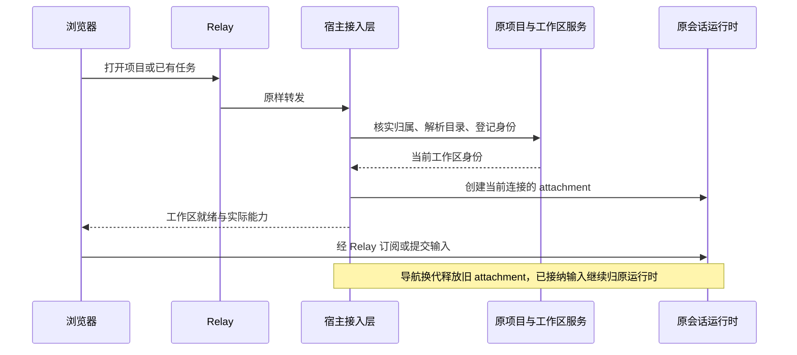

# 自建远控宿主合同

## 目标

浏览器通过现有 Relay V2 访问 Desktop 或独立 Server。两种宿主提供一致的项目、任务导航与恢复行为；独立 Server 使用自己持有的项目与会话服务。

## 项目与任务

- 项目和任务由执行主机保存，浏览器使用宿主返回的身份。
- 打开已有任务时，宿主核实所属主机、任务和工作区，再解析原会话目录，沿用现有远端单目录项目约束。
- 项目内新建任务时，宿主核实项目并准备该项目的执行目录。重复准备、导航取消和迟到响应遵守当前请求代际。
- 初始工作区用于进入主机界面；创建远端任务需要明确项目。空主机可以先创建项目，再进入该项目的新任务。
- 浏览器草稿保留用户选择的项目；首屏默认项目只在缺少已保存草稿归属时使用。显式打开另一个项目继续以该次导航为准。
- 当前主机的界面别名由宿主解释；数据库、订阅和请求关联使用稳定身份。相同路径的不同主机彼此隔离，列表与通知订阅共用实际连接端点。
- 项目界面从 attachment 获取当前目录宿主身份；当前宿主的项目直接保存，跨宿主项目沿用设备成员与连接校验。

## 连接与恢复

宿主拥有当前页面和 bridge 代际；项目服务拥有目录与组织关系；CLI 拥有会话和已接纳输入。Desktop 使用 continuous，浏览器使用 replayable。

刷新和重连重新核实原任务。相同 bridge 身份重试保持同一导航意图；新的导航取消旧准备。过期结果不能发布 ready 或覆盖新连接。bridge 失效时立即终结旧 RPC，并沿现有恢复流程重新挂接。

宿主只声明实际可用的平台与目录能力。不支持的请求带原请求关联和具体原因返回；上层可以区分导航、连接与业务错误。

## 页面版本

网页按宿主完整发布版本选择资源。已发布版本资源保持独立；首次入口选择当前页面，配对后按宿主版本校正。目标版本缺失时展示明确的版本不可用提示。浏览器重新加载后仍进入该版本资源。

## 验收

| 场景                            | 结果                                     |
| ------------------------------- | ---------------------------------------- |
| Desktop 经自建 Relay 打开任务   | 原任务、原目录、原运行时                 |
| Server 创建项目后首次发送       | 归属该项目，回复和工具结果可见           |
| 项目内新建与打开历史            | 分别准备项目目录、解析历史任务目录       |
| Desktop 和 Web 打开同一远端任务 | 会话 ID 与持久化内容一致                 |
| 刷新、网络恢复与 Server 重启    | 重新核实身份后恢复；已接纳输入不重复执行 |
| 导航并发、取消、迟到结果        | 只有当前代际可发布 ready                 |
| 两主机同路径                    | 项目、任务和订阅隔离                     |
| 旧 Server 与新网页部署          | 加载对应宿主版本的网页                   |
