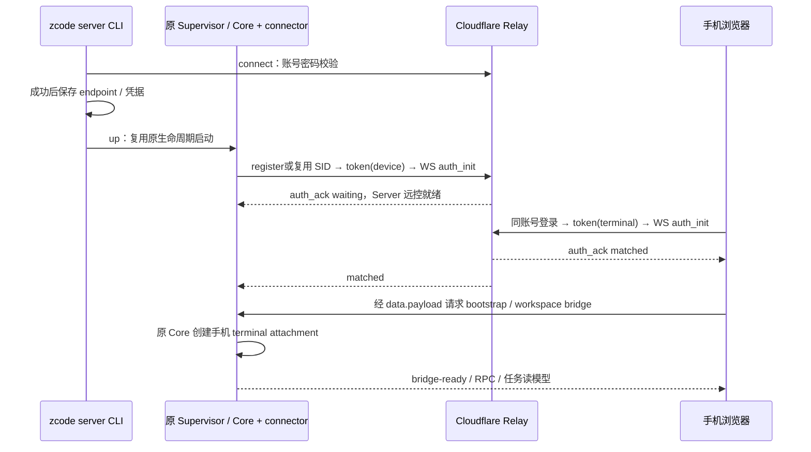

# 自建 Relay 协议：沿用官方 V2

状态：待实现合同。用户已明确不改配对与手机离线行为，本稿取代先前 Fork Remote Relay v1 多路外壳设计。

## 1. 复用与新增边界

复用 `packages/shared/src/web-remote-relay/contract.ts` 的 V2 schema、路径、角色、错误码与心跳参数；复用现有 AppPayload、RPC 分片/ACK 和 bridge 恢复合同。新自建认证使用独立 `/api/fork-remote/auth/*`，不改官方 OAuth 服务、不伪造模型平台业务令牌。

“兼容 V2”指自建两端和 Relay 的正式合同；仍需以当前 schema、HTTP/WS 真实交换与功能验收证明，不能只按文档手工复制后声明已经兼容。

## 2. 账号密码与持久凭据

部署设置固定用户名、加盐密码 KDF 校验信息及会话签名/认证版本配置；算法与成本必须通过真实 Workers 自检。无注册、多租户或组织系统。

拟新增 POST `/api/fork-remote/auth/login`：账号密码认证后返回本部署的有效用户身份、Relay API 登录凭据与过期时间。凭据使用自建签发的 JWT/明确等价的 auth port，必须满足既有入口真正依赖的 expiry/user 字段；不要求 data.zai/data.bigmodel 模型 token。实施以依赖契约测试固定最终形状，手机只替换登录入口与凭据适配。

Server connect 保存 endpoint、userId、可撤销/可轮换凭据及 V2 设备身份；不默认持久保存密码。浏览器使用既有凭据边界接入自建登录，密码本身不入 localStorage。凭据失效时停止认证重试；设备 SID 按 endpoint/user 隔离，换地址/账号不复用旧身份。

认证修改请求检查来源/CSRF；浏览器 WS 校验 Origin，Node device 用合法登录与票据认证。登录限速与密码错误是明确结果。可选的凭据续期/撤销接口在实施认证合同中固定，不顺带新增管理后台。

## 3. 原样支持的 HTTP 合同

全部 V2 API 从 Bearer 凭据取得用户身份；成功 envelope 为 code=0、msg、data，失败检查 HTTP 状态和业务 code。响应允许新增未知字段，声明字段仍严格校验；不能用 catch/可选链将契约错误伪装为空列表。

| 方法/路径                           | 输入                    | 输出与约束                                                        |
| ----------------------------------- | ----------------------- | ----------------------------------------------------------------- |
| POST `/api/v1/remote/device`        | device_mid              | 设备记录；不接收 meta，同 MID 每次注册产生新 SID                  |
| GET `/api/v1/remote/device`         | 无 body/query           | 当前账号设备记录数组                                              |
| POST `/api/v1/remote/device/delete` | device_sid              | 仅自己离线设备可删除；不存在幂等成功；在线/无归属按官方业务码返回 |
| POST `/api/v1/remote/token`         | role=device 或 terminal | 16 随机字节、22 字符无填充 Base64URL token，expires_in 正整数     |

设备记录含 device_sid、device_mid、online、created_at（Unix 秒）、meta；在线 meta 为可选 name/platform/version，离线 meta 为空。token 绑定用户和角色、不绑定 SID，60 秒有效，Upgrade 前原子单次消费，失败不恢复，响应 no-store。token 到期不影响已经建立的连接，重连必须重新申请。

本期单租户仍校验登录、角色、设备归属、状态与删除条件；不能因一个账号而把所有校验删掉。registered sourceServerId 与 wire device_sid/device_mid 分开处理，沿用 V2 身份持久化与重新注册规则。

## 4. 原样支持的 WS 合同

路径 `/api/v1/remote/ws2?token=...`，可带 mid 路由提示；票据无效/过期/重用在 Upgrade 前返回 401。角色来自票据，不接受 auth_init 改写。

| 方向           | 消息              | 关键内容                                              |
| -------------- | ----------------- | ----------------------------------------------------- |
| client → relay | auth_init         | device_sid、可选 meta、可选 client_ts；不携带 role    |
| client → relay | pair_status_query | 可选 client_ts，不携带 SID                            |
| client → relay | data              | payload、可选 client_ts                               |
| relay → client | auth_ack          | device_sid、terminal_sid、pair_status、可选 server_ts |
| relay → client | pair_status_ack   | terminal_sid、pair_status、可选 server_ts             |
| relay → client | data              | payload、可选 server_ts；不带 client_ts               |
| relay → client | error             | code、可选 message/server_ts                          |

pair_status 仅 waiting/matched；错误码仅 AUTH_FAILED、WRONG_PARAM、KICKED、INTERNAL、DEVICE_OFFLINE。时间戳是 Unix 秒，不得传毫秒；严格 schema 与官方 token 格式保持一致。

单 SID 每角色只有一个 owner。替换顺序：先验证归属/角色 → 设置新 owner → 通知旧 owner KICKED 并关闭 → 更新另一方配对状态。旧 socket close 必须检查它仍是当前 owner 才能清理。

device 断开按 V2 通知 terminal waiting/DEVICE_OFFLINE 并关闭；terminal 断开只通知 device waiting。实际手机对 waiting、后台恢复、离线延迟失败的分支沿用已有实现，不用新缓存策略覆盖。

V2 每轮心跳 5 秒 ±1 秒、ACK watchdog 15 秒等时序沿用现有 helper；首次 KICKED 的有界恢复、短窗口重复 KICKED 停止规则同样不改。多手机之间可能有一次有界反向接管，这属于保持官方行为的验收项。

## 5. Server 宿主适配

连接器实现现有 AppPayload 的 bootstrap、workspace-list、bridge-open/ready/error、必要平台请求和 rpc-frame/ack；宿主端口由 Core 注入。不得复制整个 Electron manager 或创建第二份服务容器。

当前 terminal 被替换时先撤销它的桥接/在途请求；新 terminal 获得独立 attachment。内部 connectionId/generation/owner 防护沿用现有边界，不为此添加新的 Relay wire 字段。

## 6. 传输大小与资源边界

保留最终 outer JSON 最大 1 MiB、逻辑 raw RPC 最大 16 MiB/64 片、CRC 与完整校验后交付一次、shared 累计 ACK 和现有 32 MiB/45 秒重放边界。物理字节计量与实际发送共用同一序列化结果。

Relay 不解析 task/workspace，不持久化 data.payload，不对业务命令自动重发。两端 raw adapter 是唯一重放 owner；新的 bridge 清理旧缓存，command receipt 仍由 CLI owner 产生。

本期不引入 channel-open、channelId、flow-credit 或离线队列。Worker 需要真实验证同 SID 双端转发在尺寸、速率、慢接收和断线下的有界行为。平台无法提供所需边界时必须保留明确容量限制/失败终态并评审，不能把无限队列或协议变更作为隐式兜底。

## 7. DO 休眠、持久化与日志

DO 持久保存设备、认证元数据和一次性票据消费事实；活跃 owner 从已认证 socket attachment 恢复。计时/expiry 不只存在于 Worker 全局 Map。一个聚合 alarm 处理必要到期清理，避免每连接无限定时器。

使用 hibernation 不等于所有连接必然不掉线；发布、平台中断或错误仍走已有重连。不能让休眠重建自动复活已消费票据、已删除 SID 或已被替换 owner。

日志只记录角色、阶段、设备安全标识、关联 id、错误类型、心跳/配对变化，不记密码、Bearer、WS query token 或业务正文。登录 401、Relay 5xx、设备离线、工作区无权限、模型错误分别呈现，不混成同一种成功/错误结果。

## 8. 首版发布约束

首版用同版本 shared/Web/Server/Worker 组合完成验收；校验现有 compatibility manifest，不只比较应用版本字符串。官方 OAuth 数据不迁移，旧官方域名的登录凭据不发到自建地址。

本期不处理桌面手机多对多、持久离线阅读、云端聊天存储或通知服务。官方生产 Relay 的内部存储不在本仓库，本合同只约束自建后端。
