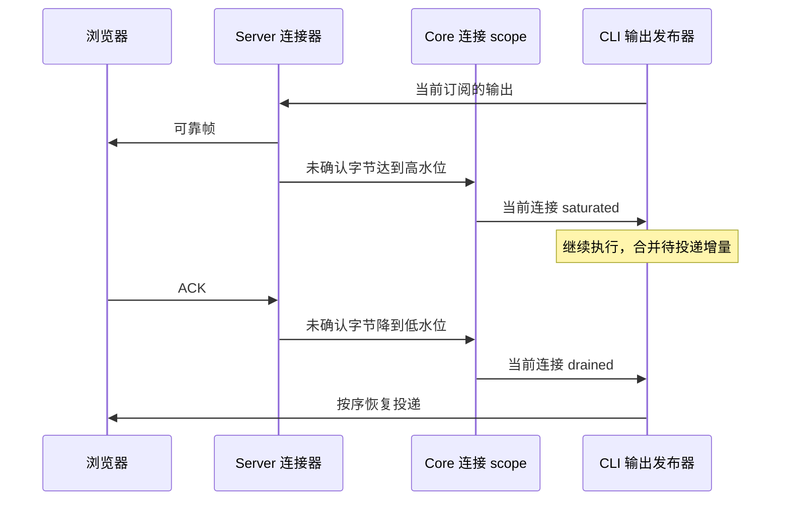

# 慢链路体验

远控默认面对高延迟、有限带宽与短暂断连。项目、任务和已接纳命令继续由 Server 的既有服务与 CLI 持有；网页保留当前视图，按原序号恢复输出。

## 输出流控

连接器以现有可靠帧的未确认字节水位判定拥塞。拥塞通知沿当前 Core 连接进入订阅 scope；CLI 暂停该连接的输出投递，并复用已有增量合并。确认排空后恢复投递。任务继续执行，命令接纳与权限结果沿原通道处理。

流控只作用于产生该信号的连接。连接关闭先封闭其流控与订阅；旧连接的排空信号不能影响新连接。流控控制消息与业务 RPC 分离，连接身份由接收端绑定。

## 导航与加载

同工作区的已有任务复用当前 bridge 与页面。当前项目的新草稿先核实项目和执行目录；目标身份与当前工作区一致时复用页面，其他项目和跨工作区仍由宿主验证并切换 attachment。导航取消与迟到结果遵循原代际约束。

当前 Host 的项目树与设备入口目录并行读取。远端项目缓存内容相同则直接使用；名称、目录、归属或删除态变化才按原版本校验更新缓存。目录读取完成前继续复核成员身份。历史消息继续使用尾部快照和按需翻页。

草稿推荐仅请求草稿场景，服务端在返回远控响应前完成筛选；完整场景目录继续由其页面请求。缓存和前台恢复按服务与场景隔离。网页输入框打开 `/` 面板时才读取子智能体目录，重复打开复用现有目录缓存。

## 验收

| 场景                                                                                      | 结果                                                                          |
| ----------------------------------------------------------------------------------------- | ----------------------------------------------------------------------------- |
| CWA31：慢接收造成未确认字节超过高水位，再逐步确认                                         | 当前 Core scope 收到 saturated、drained；CLI 输出有界合并，最终内容与顺序完整 |
| CWA32：拥塞、关闭与旧连接迟到排空                                                         | 关闭作用于原连接，新连接及 Desktop continuous 连接保持隔离                    |
| CWA33：同工作区任务与项目草稿切换                                                         | 保持 bridge 与页面，项目归属正确，跨工作区导航仍校验完整身份                  |
| CWA34：Server 到 Relay 每方向 150 ms 延迟、64 KiB/s；首次发送、刷新、重连后发送、文件浏览 | 记录阶段耗时、传输字节和排队峰值；同一命令只执行一次，历史和回复一致          |

CWA35 验证设备目录在途时当前 Host 同时读取；项目缓存相同则直接复用，变化遵守原版本比较与成员校验。

CWA36 验证草稿推荐只收到草稿场景，完整目录和业务错误保持各自结果；网页进入会话时子智能体目录请求为零，打开 `/` 后候选正常出现，再次打开复用原缓存。

弱网回放使用隔离数据目录、真实 Core、CLI、SQLite 与浏览器，模型和账号由本地夹具提供。链路限速作用于 Server 与 Relay 之间，浏览器静态资源独立加载。
