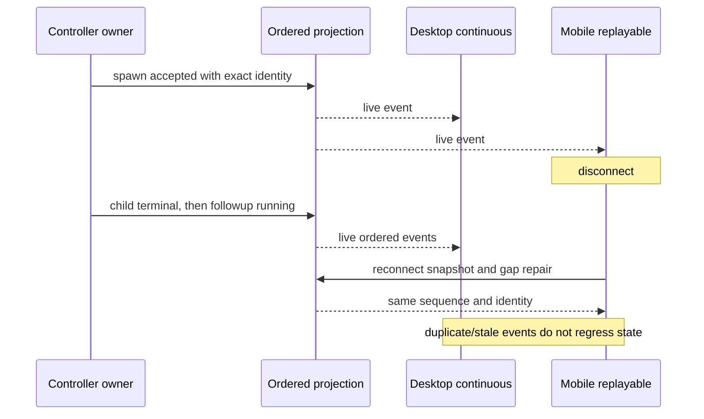

# Six-tool client and process acceptance

This document defines Task4 acceptance before implementation. Task3b supplies
the actual runtime adapter and durable internal identity facts. Client code does
not schedule children or maintain another mutable collaboration state.

## Identity and lifecycle

Only spawn_agent creates a child work item. Its model result is only task_name;
the durable internal lifecycle provides agentId, the actual childSessionId,
parent identity, original parentToolCallId, path and generation. A followup uses
the same child identity and creation anchor. No client may infer a session ID
from an agent name, task path, tool call ID or a legacy filename convention.

Test with deliberately unrelated values: agentId=agent-uuid,
childSessionId=opaque-session-id and task_name=/root/worker. Live subscription,
idle unload and cold reload must open the same child transcript. Missing facts
are diagnosed, not replaced with a fabricated session. Existing user data is
not deleted. No new special reader or tool adapter is added for old tool calls.

Spawn tool completion means accepted, not child task completion. Actual child
terminal events supply the task result. followup returns the same item to a
running state; an old generation's terminal cannot overwrite the new run.
Mailbox content is not duplicated into wait's model result.

## Tool presentation

All six tools have intentional labels and summaries. spawn_agent pairs with the
child lifecycle row, while send_message, followup_task, interrupt_agent,
list_agents and wait_agent remain actions on that collaboration. They do not
create extra children. List/wait cannot fall through to a stop renderer.

TUI shows tool name, target/message and available result or error detail. Empty
successful message results remain successful. Native child Stop remains usable
and sends an explicit interrupt to the same controller; model TaskStop is limited
to non-subagent background tasks. No legacy tool execution aliases are retained.

## Delivery contracts

Parameterize spawn, parent steer, child terminal, followup and another terminal
through both delivery kinds. Reuse the existing projection sequence owner:
duplicate or stale sequences are ignored and a gap requires resubscription.
Verify one child, exact session identity, monotonic sequence, no duplicate
completion and no terminal overriding a later running generation. Unit evidence
does not establish an actual mobile GUI run.

## Actual protocol process and HTTP recovery

Run a separate Node process with unhandled rejections treated as fatal, the real
protocol entrypoint, application, runtime, session store and model adapter. A
controlled local HTTP provider records physical requests. A fake ping-only
protocol lifecycle is insufficient.

Cover failure before first token followed by success, visible output followed
by a destroyed stream and success, and persistent failure exhausting exactly
21 physical attempts. Test fixtures can reduce backoff delay, without changing
the production 20-retry/30-second maximum contract. During recovery there is no
premature successful terminal or unhandled/fatal diagnostic. After each case,
the process remains alive and accepts another real command or input. Report
actual request counts and final error context, not only UI status.

## Evidence boundaries

Record projection tests, real runtime/HTTP tests, independent protocol process
tests and actual desktop/mobile tests separately. The previous desktop steer
5/5 replay used the earlier Agent bundle; Task3b's newly built runtime requires
its own verification. Do not mark all Task4 complete from that earlier result.
