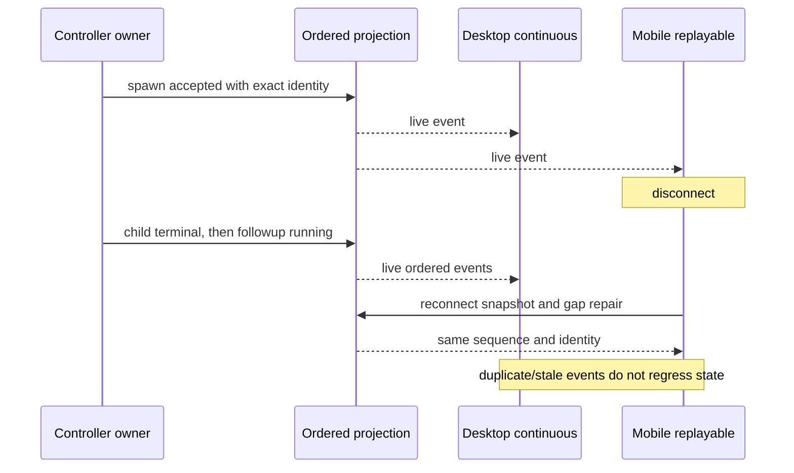
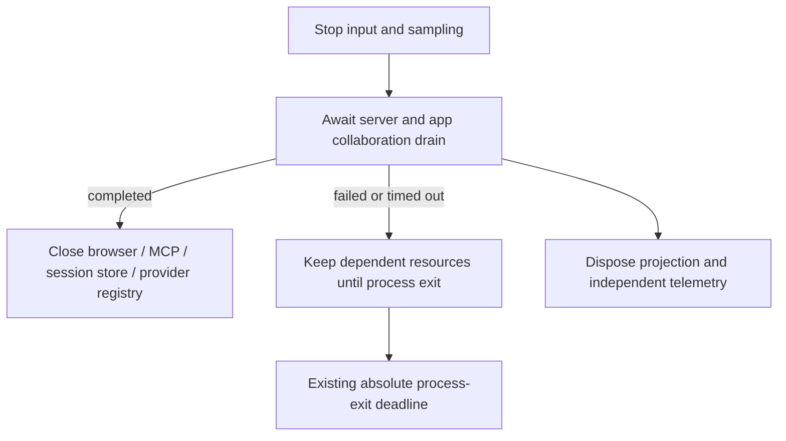

# Six-tool client and process acceptance

This document defines Task4 acceptance before implementation. Task3b supplies
the actual runtime adapter and durable internal identity facts. Client code does
not schedule children or maintain another mutable collaboration state.

## Identity and lifecycle

Task4 client implementation reads the versioned root entry through the runtime's
public persistence API. Resolve a request by checking its own root entry first;
only a persisted `subagent_child` may walk its actual `parentID` chain. Every
edge must match an accepted graph relation and the child's opaque session ID.
Missing parents, cycles and metadata conflicting with the canonical graph fail
with the session and call context. Ordinary conversation/selection forks stop
the walk and never acquire the source conversation's children.

Private spawn metadata is a strictly validated version-1 collaboration relation
in `ToolPart.state.metadata.collaboration`; it is a derived shortcut, never the
identity authority. The accepted graph recovers an accepted spawn even if the
process stopped before tool-result settlement. Tool completion cannot synthesize
a child terminal. Cold query does not initialize or schedule a controller: a
saved running child requires a live owner with actual running work; otherwise
the read model reports interrupted/cancelled until an explicit followup.

ProductProjection remains the only lifecycle row owner. Its persisted row holds
optional agentId/path/parent identity/generation; a lower generation cannot
overwrite a newer run, and a repeated running event cannot reopen a terminal
of the same generation. followup retains the original row, tool-call anchor and
opaque child session. Lifecycle replay is not inferred from a model-facing ACK.
When a canonical seed excludes a formerly projected child, remove both its row
and its child background-work entry in the same projection update. The fork
removal registry must guard the removed message renderers and the old display
discriminants in their former contracts; historical fixture text is not a
compatibility entry point.

Only spawn_agent creates a child work item. Its model result is only task_name;
the durable internal lifecycle provides agentId, the actual childSessionId,
parent identity, original parentToolCallId, path and generation. A followup uses
the same child identity and creation anchor. No client may infer a session ID
from an agent name, task path, tool call ID or a legacy filename convention.

Test with deliberately unrelated values: agentId=agent-uuid,
childSessionId=opaque-session-id and task_name=/root/worker. Live subscription,
idle unload and cold reload must open the same child transcript. Missing facts
are diagnosed, not replaced with a fabricated session. Existing user data is
not deleted. No new special reader or tool adapter is added for old tool calls.

Spawn tool completion means accepted, not child task completion. Actual child
terminal events supply the task result. followup returns the same item to a
running state; an old generation's terminal cannot overwrite the new run.
Mailbox content is not duplicated into wait's model result.

## Tool presentation

All six tools have intentional labels and summaries. spawn_agent pairs with the
child lifecycle row, while send_message, followup_task, interrupt_agent,
list_agents and wait_agent remain actions on that collaboration. They do not
create extra children. List/wait cannot fall through to a stop renderer.
Native child terminal usage is attributed to `spawn_agent`; this is telemetry
for the original accepted creation and does not create a UI item. Workflow actor
usage retains its own existing attribution and terminal owner.

TUI shows tool name, target/message and available result or error detail. Empty
successful message results remain successful. Native child Stop remains usable
and sends an explicit interrupt to the same controller; model TaskStop is limited
to non-subagent background tasks. No legacy tool execution aliases are retained.

## Delivery contracts

Parameterize spawn, parent steer, child terminal, followup and another terminal
through both delivery kinds. Reuse the existing projection sequence owner:
duplicate or stale sequences are ignored and a gap requires resubscription.
Verify one child, exact session identity, monotonic sequence, no duplicate
completion and no terminal overriding a later running generation. Unit evidence
does not establish an actual mobile GUI run.

## Actual protocol process and HTTP recovery

Run a separate Node process with unhandled rejections treated as fatal, the real
protocol entrypoint, application, runtime, session store and model adapter. A
controlled local HTTP provider records physical requests. A fake ping-only
protocol lifecycle is insufficient.

Cover failure before first token followed by success, visible output followed
by a destroyed stream and success, and persistent failure exhausting exactly
21 physical attempts. Test fixtures can reduce backoff delay, without changing
the production 20-retry/30-second maximum contract. During recovery there is no
premature successful terminal or unhandled/fatal diagnostic. After each case,
the process remains alive and accepts another real command or input. Report
actual request counts and final error context, not only UI status.

## Evidence boundaries

Record projection tests, real runtime/HTTP tests, independent protocol process
tests and actual desktop/mobile tests separately. The previous desktop steer
5/5 replay used the earlier Agent bundle; Task3b's newly built runtime requires
its own verification. Do not mark all Task4 complete from that earlier result.

## Production shutdown dependency order

The production entrypoint has an absolute process-exit deadline. Its bounded
cleanup must distinguish an app owner that actually drained from an owner whose
shutdown failed or is still pending. A timeout ends the wait; it does not prove
that children stopped writing.

Do not close a shared store, MCP lease/pool, browser broker or provider registry
under a still-pending app shutdown. Log the failed owner and original error or
timeout context, plus the dependent resources deliberately retained. Do not
start detached late cleanup: the process lifecycle owns the final deadline.
Independent diagnostic cleanup is still attempted. No session is deleted and
no session-removed event is generated by process shutdown.

The app resource owner also tracks app creations accepted before shutdown.
A successfully resolved drain includes their settlement and cleanup of any
late app; rejecting publication alone does not establish that shared storage
is no longer in use. A hung accepted creation therefore leaves the drain
pending and uses the same process deadline, rather than falsely reporting a
completed drain.

Before changing production cleanup, add regressions for a gated app drain:
no dependent close before the gate, each dependent closes once after success,
and a failed/timed-out drain retains those dependencies even if it settles late.
Cover an app factory gated across shutdown: close remains pending until the
late app is closed, the accepted create rejects publication, and no new create
is accepted after stopping.
Retain the existing shared-deadline and independent-cleanup assertions. The
independent HTTP fixture bypasses this production wrapper and cannot establish
these semantics.

Keep this infrastructure fix in the managed bootstrap fork module
`src/fork/codex-collaboration-shutdown/`. The existing protocol cleanup and
resource-owner files remain thin re-exports, so callers retain one public
implementation and future upstream merges do not compete with a copied owner.
The module accepts finite cleanup ports; it does not require a concrete SQLite
store, maintain session state, or add a second process deadline.
