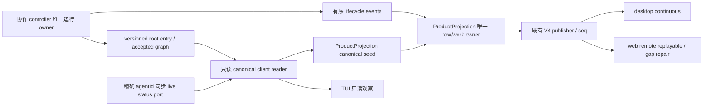

# 六工具客户端实现与验证

实现范围：shared identity/协议、共享 UI、bootstrap V4/冷查询、TUI 及相邻契约测试。
控制器、模型请求重试、HTTP 进程恢复和关闭屏障由 runtime 实施与整体验收负责。

## 单一事实与所有者

bootstrap managed module `codex-collaboration-client` 负责有限的读取与校验：先查请求会话自身
root entry，仅沿真实 `subagent_child` 逐级验证 accepted parent edge。普通 UI fork 的 parentID
只表示正文来源；即使复制的 part 被重新写入当前 session，metadata 的原 parentSessionId
也不会使新 fork 收养来源 children。缺失 parent、cycle、canonical/metadata 身份冲突均明确报错。

私有身份读取 `ToolPart.state.metadata.collaboration`，同时校验已有 part metadata；严格 schema
错误带 session/call 和原始 cause。身份来自 root snapshot，model selection 来自真实 child session
entry，metadata 不成为另一条 identity owner。spawn 的旧 generation 可对应后续 canonical generation；
未来 generation、错误 opaque child ID/path/parent/anchor 不可接受。

冷读取不初始化 controller、不调度模型、不持久化虚构终态。通过公开同步
`AgentRuntime.getCollaborationAgentStatus(agentId)` 读取精确 child 当前状态；saved running
没有活 owner 时仅在 read model 显示 cancelled，不能被正在运行的兄弟或 Bash 冒充。
accepted graph 能恢复 accepted-before-tool-result crash gap，无需模型结果内含 ID。

## 展示与接线

- shared known tools 只登记六个新名，旧四工具不再归为 agent/message family。
- managed UI module `codex-collaboration-ui` 提供中英文动作标签、target/message、path prefix、
  agent type、fork turns、模型覆盖和 timeout 详情；list/wait 不落到默认 Stop renderer。
- 只有 spawn 按原始 tool-call anchor 配对 child。tool result 完成只代表 accepted；配对摘要状态
  取真实 lifecycle row，下钻使用该 row 的 opaque childSessionId。
- 配对 spawn 摘要的主动作仍是打开该 opaque childSessionId；参数详情使用独立 disclosure，
  不能因主动作存在而禁用内容渲染。用户可在不离开父会话的情况下查看主代理实际发送的
  `message`，展开详情不得触发下钻，主摘要下钻也不得隐式切换详情状态。
- ProductProjection 保存可选 typed generation/agent/parent/path。重复事件、旧代或无代迟到终态
  不覆盖新运行；同代 terminal 不被 running 重开；相同 anchor 的不同 agent 明确诊断。
  followup 复用原 child 与创建 anchor，不增加 child UI item。
- SubagentSpawned 与 SubagentStopped 在同次 projection transaction 更新后台工作。canonical seed
  撤销无效 child 时同步移除 row 和 subagent work，Bash/workflow work 保持原 owner。
- transcript hydration 不解析旧 ACK/JSON 身份、不从 tool result 或 subtask 合成 child terminal。
  cold merge 保留真实持久 lifecycle，V4 bridge 以 canonical seed 校验最终 manifest。
- 删除旧 send-message、respond-to-coordinator、agent renderer、agent prompt section 及旧展示专属测试；
  删除旧消息 display discriminants 的 contracts/shared/UI reader。agentHelpers 仅保留新 spawn 标题读取。
  native child token usage 归于 spawn_agent，workflow actor 归因保留独立既有语义。
- TUI 六工具具有明确 summary、参数与结果，空成功结果保持 completed。TaskOutput/TaskStop 继续
  服务 Bash/workflow；native child stop 由原 controller interrupt 路径处理。
- fork-removal registry 只在指定 identity/display 文件及被删 renderer 路径设置守卫，不扫描历史 fixtures。

## 验证与边界

所有行为按 client acceptance 先写 spec、执行失败测试，再实现。实际 RED 记录包括 identity、
六工具 renderer、canonical cold reader、旧 display schema、cold seed work 残留、anchor 身份冲突、
fork 复制 metadata、无 generation 的迟到终态、metadata 报错上下文、参数详情及 native telemetry。

定向 UI/shared、bootstrap、TUI、CLI observation、contracts 与移除守卫结果和命令见本批
Agent Note。publisher → renderer store 的同序列测试参数化 continuous/replayable，实际覆盖重复帧、
parent steer、丢帧 gap resync、同 child followup 和旧 generation；没有新 cache 或传输 owner。
这些是协议/投影单测，不能冒充手机实机验证。

协作邮箱保持 Codex 的 assistant 信封身份。若本次请求最终投影以 durable collaboration 信封
结束，Core 在 provider-only 尾部追加一条不含载荷的宿主继续边界，明确前一条是内部代理消息
而非 assistant prefill。该边界不持久化、不显示、不更新 latest-real-user，也不根据输出文本猜测
reasoning；provider 正确返回的 reasoning 仍由原有 reasoning 事件链折叠展示。普通模型正文即使
很长也不得被启发式改判为思维链。

桌面 Electron CSC01 已追加“先在父会话展开 spawn 详情、再下钻子会话”的候选断言。case-local
fixture checker 通过；fresh renderer 与 Core 构建通过，但完整 Agent bundle 被未修改的
`zcode-site-plugin` 无法解析 `@zcode/shared/zcodeEndpoint` 阻断。复用 bundle 的窗口回放又被
Electron 44.7.0 缺少 Chromium mapping 阻断，因此本轮没有把 CSC01 记为 GREEN。已有多次实际
GREEN 只代表各自旧构建快照。继续边界由 Core provider 投影回归验证，界面分流由 UI 契约测试
验证；未运行全量 UT，未执行手机 GUI 验收，未 push。
