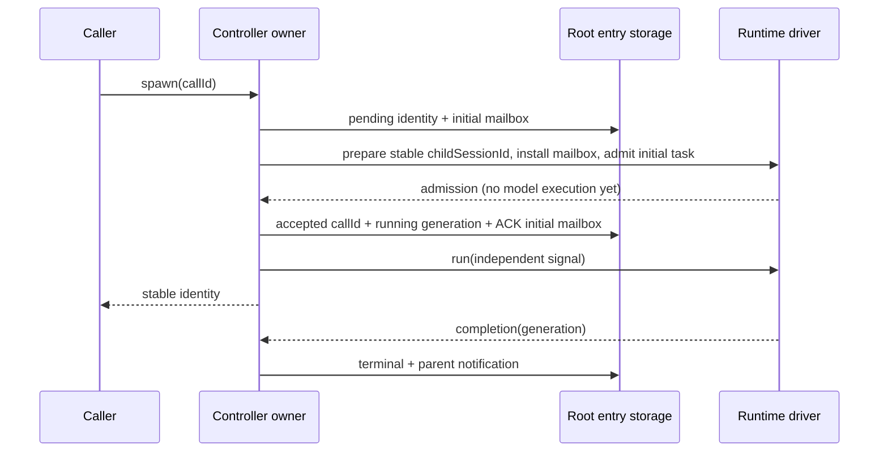

# Task 2: root-owned collaboration controller

状态：实现中；独立控制器，不接线旧 registry 或六工具（Task 3）。

## 所有者与有限端口

`core/src/fork/codex-collaboration` 的 app controller 是身份树、接受调用 ID、FIFO 邮箱、run generation、运行名额的唯一所有者。
`RuntimeDriver.prepare` 只创建/恢复原 childSessionId；返回的 handle 先安装 mailbox，再 admission。
`admit` 返回一个尚未执行模型的 admission；只有接受快照保存成功后才调用其 `run`。
每轮独立 AbortController。RuntimeDriver 的 prepare、deliver、admit、release 都必须有界结束，不能反向等待 controller command。
root 的消息也走相同 durable ACK 端口，由宿主提供 root handle；root 不由 controller 启动。
持久化端口只读写一个版本化 root session entry；写入须原子、按调用顺序完成，失败不能部分提交。
时钟和 ID 由 driver 提供；core 不直接做文件、计时器或 provider IO。

## 行为与错误

- 默认总并发4（root永久保留1）、驻留child3、深度1，均为正整数配置；根深度0。
- path 规范 `/root/a_b`，段只接受小写字母数字下划线且不能是 root；同树 id、规范绝对路径和相对调用者路径共用解析。
- 每个 mutation 串行 admission；completion 独立排队，不在 command admission 中等待模型。
- send 只持久入箱，已加载运行者通过唯一 sink 转移；空闲者不启动；followup 在原身份/会话恢复并启动。
- deliver 只有收到与消息 ID 一致的 durable ACK 才出箱；失败保留消息，抛出携带阶段/目标/cause 的错误。adapter 须按 message ID 去重，以覆盖 ACK 后快照保存失败。
- initial/followup task 由 `admit` 接收；其 admission 同样按 message ID 去重；`cancel` 释放尚未 run 的 admission，不能删除已提交的会话历史。
- admission 前失败回收临时 runtime/名额/新身份；accepted 后调用者 abort 无权停止 child。相同 callId 与同一请求返回同一身份；冲突请求报错。
- terminal 释放运行名额；error/interrupted 保留 transcript、身份和未读消息；interrupt 只停止目标，禁止root/self，旧 completion 不能改写新 generation。
- 容量不足/身份冲突/权限路径/缺失持久化能力/损坏快照/会话恢复失败均为独立错误码并保留 cause，绝不创建空白替身。
- 驻留上限独立于身份；缺名额先卸载 idle handle，所有身份与未读消息保留；running 不卸载。list只显示已加载者（含root）。
- 冷恢复把 running 改为 interrupted 并保存，继续用原 childSessionId；不重放旧模型执行。
- wait先订阅再检查 durable unread/terminal活动，默认30秒、最少10秒夹紧、超过3600秒拒绝；steer/abort只结束wait，不影响child。wait不消费邮箱；唯一 sink 才消费。
- 宿主关闭由 dispose 显式中断child；未知持久化失败由 flush 暴露，不产生 unhandled rejection。

## 验收

fake drivers 验证持久接受顺序、幂等调用、晚到caller取消、消息ACK失败重投、恢复原history、并发/驻留/深度、跨树路径拒绝、generation隔离、wait注册竞争、失败清理和schema拒绝损坏数据。
Task 3 必须实现真实 session entry adapter 与 durable message ACK，并移除旧 registry 对子代理状态的独立写入；本模块测试不能替代 Desktop/Web集成验收。

## 实现细化（2026-11-02）

- spawn 去重键为 `(callerId, callId)`，同一调用方参数变化报 CALL_ID_CONFLICT；不同子代理可以复用供应商局部 tool-call ID。
- 冷恢复遇到没有 accepted 记录的临时身份，由 idempotent release(identity, undefined, {discard:true}) 清理，避免失败的占位永久挡住重试。
- subscribe 提供 detached snapshot，供 registry/UI 派生投影；保存后以及驻留变化时通知。观察者异常由 flush 显式报告，不能回滚已经持久接受的任务。
- 父/idle 邮箱由宿主在安全边界调用 deliver；wait只通知活动、不替代消费。running send/followup 通过相同 durable ACK sink 交付。
- interruption 会留下可冷恢复的 STATUS，不伪造 FINAL_ANSWER；同一 agent 的后续 generation 过滤迟到结果。
- terminal 保存失败保留 completion 并经 flush 报错；持久层恢复后再次 flush 重试。清理失败用 AggregateError 同时保留原始失败与各清理失败，回收未接受的身份，并保留待重试资源。

## Task 2 审查修正：拒绝危险恢复与保留清理证据

- 没有 accepted 记录的 child 只能是 `idle + generation=0` 的接受前占位。running、terminal 或非零 generation 缺失接受记录属于损坏快照，必须在任何 discard 清理前拒绝，不能把历史当作未接受会话删除。
- installMailbox 与 release 同时失败时，结构化 prepare 错误必须同时保留原失败与清理失败，并保存原 runtime 句柄用于下一次清理；恢复已接受会话时禁止 discard。
- 接受保存/取消检查失败后，独立 run signal 必须被 abort；admission.cancel 失败不能覆盖原触发错误。保留未完成 admission 清理，flush 先重试 cancel，再释放相应 runtime，禁止在未完成清理的 runtime 上启动新轮次。

- flush 重试 runtime.release 成功后必须执行与正常卸载相同的 loaded 删除和投影通知；身份、accepted 记录、邮箱与会话历史保持。重试保留原 discard 选项，已接受会话只能 discard:false。后续 followup 必须重新 prepare 原 childSessionId，不能复用已经 release 的句柄。

## Task 2 quality：清理与admission串行化、宿主关闭

- pending release 的句柄处于隔离状态，不可作为新admission或mailbox sink使用。followup先在原命令通道重试该身份的cancel/release，再prepare原会话；清理失败继续报告原阶段错误，不能启动轮次。
- flush的清理重试与spawn/followup/interrupt共用唯一串行admission通道。释放driver等待期间，后续命令不能进入；旧清理不得删除替换后的句柄或新generation。
- dispose开始后立即关闭普通command admission并abort所有child signal，不依赖快照写入成功。之后分别尝试保存interrupted状态及所有资源清理；单个保存或释放失败不能阻止其他child停止与释放。
- dispose的复合错误保留各自code、phase与cause；失败的快照和资源清理保留给显式flush/dispose重试。关闭后普通命令仍报CLOSED，但维护重试继续可达；成功重复dispose为幂等操作。parent/root store由宿主保持打开直到await资源清理结束，不能因首次dispose异常提前关闭driver依赖。
