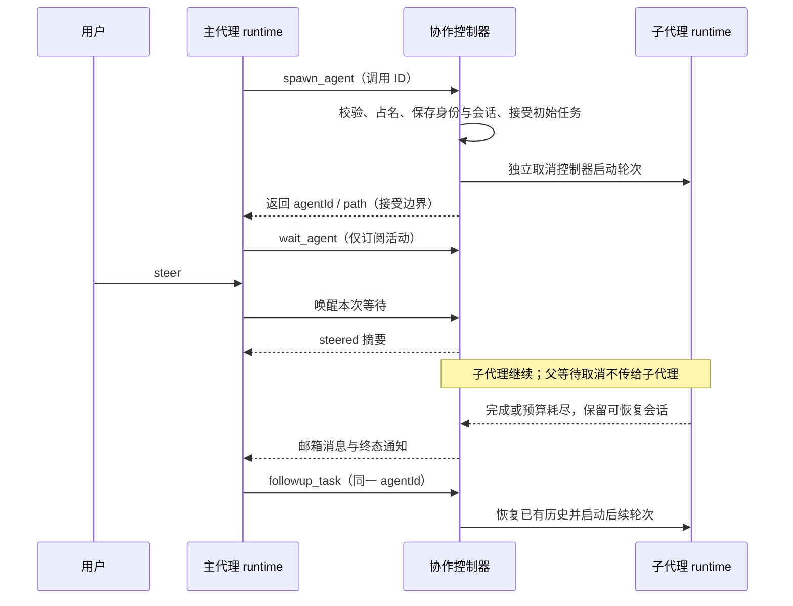

# Codex 协作调度与模型 API 恢复

日期：2026-10-29。状态：用户已批准实施并验证；按实施计划执行。

## 2026-11-02：steer 语义更正

用户明确要求：steer 在当前模型请求完整返回后插入，不能中断当前对话或传输中的流。
运行中“立即发送”与手动提升队列项均属于 steer，禁止 stop-then-start。
复用 Core 的 guide 消费边界与 reservation，不通过解绑子代理信号来掩盖父流被取消的问题。
原队列项成功重新转为 guide 时，live 与 replay 投影都必须清除上次降级原因；仅编辑正文时仍保留原投递事实。
完整时序、跨端合同及不适用项见 [turn-steering.md](../../../apps/zcode-cli/docs/design/v2/loop/turn-steering.md)。

## 目标与来源

按用户要求先同步当前仓库，再解决长任务遇到 API 错误退出、子代理不能续跑、
父会话 steer 连带停止子代理的问题。调度、工具和提示词以 OpenAI Codex 的
MultiAgent V2 为移植基准，重试次数和间隔以用户明确要求为准。

- ZCode 基线：`adbc5993122039d292cb42120f287f86d6183601`；已 fetch origin/main，
  fast-forward 检查结果为 Already up to date。
- Codex 基准：[`6b3b3349f3f559d65b101998a65cad44e5b2ee7b`](https://github.com/openai/codex/tree/6b3b3349f3f559d65b101998a65cad44e5b2ee7b)。
- 源码是 Rust，ZCode runtime 是 TypeScript。本方案移植该版本的协作契约、
  状态所有权和提示词，通过 ZCode 自有执行器实现；不引入另一个模型服务。
- 移植的代码和提示词保留 Apache-2.0 归属、原始许可证及适用的 NOTICE；
  引用固定提交，后续升级通过契约差异审查。

## 已确认的代码事实

| 位置 | 当前行为 | 影响 |
| --- | --- | --- |
| adapters/src/model/retry-policy.ts | 默认 10 次重试，最长 60 秒；配置可放大 | 不满足 20 次、30 秒的边界 |
| adapters/src/model/runner-retry.ts | 合理 Retry-After 可以越过 maxDelayMs | 单改默认间隔仍可能等待数分钟 |
| core/src/runtime/methods/streaming-recovery.ts | 输出后的恢复另外计算 10 次 | 与 adapter 预算分离，不能保证统一上限 |
| core/src/runtime/methods/model-request-session-type.ts | workflow child 使用无上限预算 | 需要一并收敛 |
| core/src/subagent/runner.ts | 前台 run 将调用者 signal 传入 child AbortController | 父工具取消会取消已开始的子任务 |
| core/src/subagent/runner.ts | SendMessage 可以恢复 registry 中的终态子任务 | 并非完全没有恢复机制；必须保留和改善现有历史恢复 |
| core/src/runtime/methods/subagent.ts | 子 runtime 配置 subagents.enabled=false | 与 Codex 的可嵌套协作工具面不一致 |
| core/src/subagent/runner.ts | 创建及消息投递存在会话 ready、消息 sink 注册等异步边界 | 必须覆盖 steer、失败和续跑竞争 |

上述 CLI 路径相对于 `apps/zcode-cli/packages/`。用户描述的具体 steer 操作尚未通过
真实 UI 场景复现；signal 耦合是确认存在的缺陷机制，不把它表述为所有现场的唯一根因。

用户进一步强调：已有重试设置并不代表实际会重试，存在请求首次失败即停止、输出途中断流
即停止的现场。因此必须修复错误准入和恢复交接，不能仅修改重试常量。

已确认的补充证据：failure-classifier 对未识别错误默认不可重试；failure-inspection
仅凭 AbortError/ABORT_ERR 名称也会判为取消，未要求真实用户取消来源；runner-stream
在已输出后禁止 adapter 重放，部分 TerminalStreamChunkError 直接上抛；无工具的 core
恢复还要求已有输出字节且命中独立的瞬态错误判断。两层之间存在失败直接结束轮次的分支。
CLI 的未处理异常边界会关闭协议进程；尚未证明现场 API 错误从哪条异步链逃逸到此处。

## 方案选择

| 方案 | 适用性 | 决策 |
| --- | --- | --- |
| 移植 Codex V2 协作契约至 TypeScript，由 ZCode runtime 执行 | 保留现有提供商、权限、工具执行、存储和客户端；可逐条对照源码 | 推荐 |
| 嵌入 Codex Rust app-server，另起执行进程 | 还要迁移模型协议、工具执行和会话桥接，改动远超调度 | 不采用 |
| 继续修补旧 Agent/SendMessage 前后台分支 | 无法完成用户要求的完整 Codex 工具、提示词和生命周期替换 | 不采用 |

## 1. 模型请求统一重试

### 1.1 次数与时间

- 一条连续失败的模型请求恢复链，首次请求后最多重试 **20 次**，最多 21 次物理请求。
  收到完整成功的模型响应后结束本链；下一次正常模型步骤创建新预算。
- 退避上限序列为 `2s → 4s → 8s → 16s → 30s → 30s ...`。
  保留现有抖动时，实际等待在本次上限的 50%～100%，避免并发同时重试。
- Retry-After 可影响等待，但最终等待不得超过 30,000ms；环境变量和调用者配置
  可以降低次数或间隔，不能提高用户规定的硬上限。
- SDK 内置重试不得叠加；adapter、流恢复、鉴权刷新、空响应恢复、模型退回
  都必须消耗同一失败链预算。没有 workflow 无限重试或供应商豁免分支。
- 单次加速模型失败后仍可按已有声明退回会话模型；退回消耗本链下一次请求机会，
  不在两个模型之间反复切换，不另起预算。

### 1.2 错误范围

已经发起的模型 API 请求失败，包括 HTTP 4xx/5xx、供应商 API 错误、网络中断、
超时和流中错误，进入同一重试预算。401/403 先尝试已有合法凭据刷新机制，
仍失败则按预算等待重试，不循环弹出登录或权限对话框。
真实上下文超限继续走现有压缩恢复路径；产生的新物理请求同样计入失败链。

用户显式停止、权限拒绝、本地配置/输入校验、找不到模型和
`FORK_UPSTREAM_REQUEST_BLOCKED` 是本地控制结果，不伪装成 API 失败反复发送。
工作区、工具执行和程序错误保留原始错误语义。

预算耗尽后，该轮次进入可恢复错误态并展示最后的错误、次数和原因；
保留主、子会话历史和身份，允许用户或父代理续跑，不退出整个应用。
不得把失败伪装为成功，也不得在第 20 次后继续自动重试。

### 1.3 流恢复与副作用

- 尚未提交可见输出时，adapter 可以安全重开请求。
- 已输出文字或接受工具调用时，由 runtime 选择现有安全锚点，结算已接受工具，
  丢弃未提交尾部，再发起请求。不能在 adapter 隐式重播整条流。
- 已提交的工具结果按原 toolCallId 保留，不能重做文件写入、命令或已接受的 spawn。
  副作用不明的工具结果明确标记，提示模型先检查当前状态。
- 每次物理请求使用新的 requestId；恢复链 ID、traceId 和累计次数保持关联。
- 重试等待必须立即响应显式取消，完成后移除 timer 和 abort listener。
- 正在退避、等待用户权限、等待消息是明确状态；activity watchdog 不得把这些
  合法等待判为“子代理死亡”。网络请求自己的 idle timeout 仍保留。

### 1.4 不能漏过恢复入口

- 首 token 前失败、只输出 reasoning 后失败、正文中途失败、tool 参数中途失败和
  已提交工具结果后的失败分别覆盖；错误块、迭代器 reject、无终态的 EOF 均须有去向。
- 底层 fetch/socket 自行产生的 AbortError 不能等同于用户主动取消。
  取消须来自当前执行的明确控制信号；内部 timeout/断网仍进入 API 恢复预算。
- 未识别的 API 响应/传输失败默认进入有界重试，保留原始错误码和 cause；
  不依赖供应商写 isRetryable=true，也不通过匹配错误文案决定核心控制流程。
- 已输出后的 adapter 停止重放是副作用保护，必须将失败交给 runtime 恢复，不能直接终止任务。
  未完整结束的流不能只因曾输出文字就标记为完成。
- 每条模型异步任务和流清理 promise 由所属执行所有者接管；可恢复 API 错误不能逃逸成
  unhandledRejection。保留真正未知的进程故障边界，不能用全局吞异常维持假存活。
- 验收观察实际后续 HTTP 请求、任务状态和子进程存活；“显示了正在重试”不足以证明成功。

## 2. Codex V2 工具与交互契约

新会话只向模型曝光一套协作工具，不同时宣传旧 Agent 与新调度方案。

| 工具 | 输入 | 行为 |
| --- | --- | --- |
| spawn_agent | task_name, message, fork_turns?, agent_type?, model?, reasoning_effort? | 接受任务后返回 `{task_name}`，不等待最终答案；身份和有效设置保留在内部事件 |
| send_message | target, message | 进入邮箱；运行中在安全边界递送，空闲时不启动新轮次 |
| followup_task | target, message | 运行中递送任务；空闲、报错或被中断的子代理恢复同一会话并启动新轮次 |
| interrupt_agent | target | 只中断目标当前轮次，返回此前状态；身份、历史和邮箱继续存在 |
| list_agents | path_prefix? | 返回 `{agents:[{agent_name,agent_status}]}`，仅列当前树中已加载代理 |
| wait_agent | timeout_ms? | 等待邮箱活动、终态通知、用户 steer 或超时，返回 `{message,timed_out}` |

具体 JSON schema、工具描述及状态输出对照 Codex 的
`codex-rs/core/src/tools/handlers/multi_agents_spec.rs` 和 `multi_agents_v2/`。
沿用 ZCode 的 schema 校验、权限、hook、ToolSearch、结果预算和调用追踪入口，
不能从新工具绕过现有执行链。

send_message / followup_task 成功时返回空文本；interrupt_agent 返回 `{previous_status}`。
内部 agentId、childSessionId、父关系及模型设置供宿主事件与 UI 使用，不额外塞进 Codex
默认模型返回。输入禁止未知字段，wire schema 沿用 Codex 的 strict:false，执行端严格校验。
工具面只接受文档公开的 fork_turns all/none，不接入源实现兼容的旧数字字符串。
拒绝 root 作为任务名，路径不能含空段、`.`、`..` 或末尾斜杠。

`wait_agent` 默认 30 秒，最短 10 秒，最长 3,600 秒；小于最短值时夹紧并在结果说明，
超过最长值拒绝。超时不会停止任何代理；邮箱正文另由唯一收件路径注入上下文。
先建立订阅，再检查未读活动，避免注册等待时漏掉并发完成或 steer。

### 2.1 身份与消息

- 根路径 `/root`，子路径 `/root/<task_name>`；task_name 使用小写字母、数字和下划线，
  同一父路径下不可重复。稳定 agentId 和 childSessionId 独立于显示路径。
- target 接受 ID、相对任务路径或规范绝对路径；解析范围限制为当前根树，不能跨会话寻址。
- 子代理能够向父代理和同树其他代理发送消息。followup_task 不允许以 root 为目标；
  interrupt_agent 不允许以 root 或自身为目标。
- 邮箱由一个协作控制器所有，按接收顺序 admission；消息 ID 保证恢复与事件重放不重复消费。
  send_message 不等于“对方已读”，返回的是接受结果。
- 子代理完成时自动向直接父代理投递最终答案和状态通知，保留任务发起者关联。
  父代理忙时在安全边界消费；父代理已结束时通知留待下次轮次消费，不自行生成无限空轮次。
  中断只产生状态变化，不伪造 FINAL_ANSWER。

### 2.2 提示词与上下文

- 移植 Codex 的 root/subagent 角色文本、六工具指引、消息信封和 fork 规则。
  Codex 使用 developer 角色；ZCode 的跨提供商模型合同仅支持 system/user/assistant/tool，
  因而将角色块作为宿主所有的 system section 装配，保留私有来源标记。
  新子代理的 fork 历史删除父协作角色/模式片段，加入自身身份和角色；不扩大公共协议角色集合。
- 消息使用 NEW_TASK / MESSAGE / FINAL_ANSWER，携带 Task name、Sender、Payload；
  保留源身份，不能把子代理消息当真实用户指令，也不能重复包装。
  对齐 Codex 的 provider 可见 assistant 身份；持久化复用带协作 metadata 的 synthetic
  record，在唯一投影边界转换，冷恢复须保留同一来源信息。
- `fork_turns` 只允许 all / none，默认 all。all 继承父模型和推理等级，不接受覆盖；
  none 时允许经过验证的 model / reasoning_effort，保留 ZCode 现有提供商选择边界。
- 保留自定义 profile、skills、memory、AGENTS.md 和允许工具配置作为角色扩展，
  profile 工具集合只能缩小父可用工具范围，并继承静态 deny 与网络限制。
  普通 profile 缺省审批模式继承父有效模式（含 plan）；内置 Explore 沿已有 Explore 策略。
  用户显式配置的 profile.permissionMode 按既有模式策略解析，可覆盖缺省继承的 plan，
  guarded 对派生 yolo 的约束仍保留。此次工具交集修复不重定义审批模式。
- 基础协作规则允许子代理继续委派；是否实际暴露 spawn 由继承权限和深度限制决定。
  工具不可用时提示词不能宣称可以调用。显式委派/主动委派模式使用同一配置来源。
- 只移植当前环境实际具备的能力说明；不复制 Codex 专用 functions.exec/recipient
  语法，也不声称 ZCode 具备未接入的宿主能力。

## 3. 生命周期和唯一所有者

根 runtime 所属的协作控制器拥有代理树、运行句柄、邮箱、取消控制器、并发名额和恢复入口。
child runtime 只执行自己的会话轮次；UI、TUI 和事件投影不创建第二份调度状态。
现有 runtimeTaskRegistry 继续拥有 Bash/workflow 任务；子代理记录由协作控制器派生投影，
旧入口只转发给同一控制器，不保留独立可写的子代理注册表。

- spawn 接受前由临时所有者负责失败清理；接受后归控制器所有，调用者取消或结果发布失败
  不能撤销已接受子任务。按调用 ID 查回接受记录，避免重试产生重复子代理。
  接受边界要求图和 child 已持久化、邮箱端点已安装、初始任务已经 admission；
  不能用当前 onSessionReady 在 executeTurn 前触发的顺序，也不能靠轮询等待 sink。
  按调用 ID 去重是 ZCode 的恢复约束，不宣称是已确认的 Codex 原生保证。
- steer、主轮次结束、wait 超时或取消均不停止已接受子代理。
  UI 普通停止按钮中断所选会话轮次；“停止所有代理”及宿主关闭才显式停止整棵树。
- interrupt_agent 只中断目标轮次；正常完成、错误、中断都释放运行名额并保留会话。
  宿主关闭才销毁活跃资源。不得用已 abort 的 controller 启动下一轮。
- 同一代理 followup、interrupt 和消息递送经同一 admission 串行化；启动新轮次
  使用递增 generation，旧轮次迟到结果不能覆盖新状态或释放新名额。
- 冷恢复从现有 session store 和代理关系记录重建身份；不会把崩溃前 running 直接当成仍在运行。
  followup 恢复使用原 transcript；缺失或损坏时报出可诊断错误，不创建空白替身。
- 对齐 Codex 的运行容量、驻留 runtime 和已知身份分离：默认每树 4 个总并发名额，
  其中为根保留 1 个，允许 3 个运行中的子代理。完成、报错和中断释放执行名额。
  同时限制驻留子 runtime 数；空闲 runtime 可以卸载，稳定身份和未读邮箱不能丢失。
  list_agents 只列已加载的代理；中断已知但未加载的代理不强行唤醒，返回先前 not_found 状态。
  并发上限可配置，配置总名额包含根。
  嵌套深度默认 1，沿用 Codex 默认；配置提高后子代理使用同一根树容量，不能绕过上限。

持久化复用带版本和运行时 schema 校验的根 session entry；保存身份图、generation、
接受调用 ID 和未读消息，不新增数据库表。需要持久化的运行必须明确取得 sessionEntries /
saveSessionEntry 能力；缺失时报出诊断，不能假装冷恢复可靠。临时会话使用显式内存适配器。
deliver 必须确认消息所有权转移后才出箱；旧 runner 终态清理会删除 pendingMessages，
因此不能继续把它当作邮箱所有者。旧 branchGeneration 继续保护 rewind，独立 run generation
保护同一代理后续轮次，二者不能替代。

## 4. 全量切换与落地边界

- fork 新能力集中到 core/adapters 各自的 `src/fork/codex-collaboration/`，
  新模块先声明 managed 架构边界与 contract；避免在既有大 runner 中继续堆分支。
- 契约/schema 在 `@zcode/contracts` 公共入口导出；计时和 API IO 留在 adapters，
  生命周期 admission 在 core app 层；不让纯领域规则依赖 timer、文件或 provider SDK。
- 2026-11-02 用户明确取消旧工具兼容要求。废弃旧子代理工具 Agent/Task、SendMessage、
  RespondToCoordinator，移除注册、执行入口、别名转发、工具搜索、权限名映射和提示词中的旧用法；
  全面使用六个新工具，不设置隐藏兼容入口，也不因注入旧端口而恢复旧模型工具。
  对旧工具的直接调用明确报告工具不存在，不静默转成新工具。
- TaskOutput/TaskStop 保留 Bash/workflow 等非子代理用途，删除其子代理查询/停止分支。
  旧子代理 runner、registry 写入和消息执行路径在新 owner 接线后清理，不留下双轨调度。
  现有会话与日志数据不删除、不迁移；不为旧调用增加专用恢复或呈现适配。
  新工具的会话恢复、工具结果配对和下钻仍必须完整验证。
- 同步移除示例、内置技能和当前功能文档中的旧工具指导，并通过 fork 移除守卫与工具目录
  契约测试防止上游同步重新引入旧入口。守卫针对注册和调用行为，不能只检查旧文件是否存在。
- ZCode Protocol V4、TUI 和 desktop 的子会话下钻、usage、权限请求和文件 checkpoint
  继续使用同一 childSessionId；新增状态字段经过 schema 校验后投影。
  desktop continuous 与 mobile replayable 都消费同一有序事件，恢复序号不能倒退。
- 不恢复账号服务、营销、遥测或被切断的上游请求；API 重试不得绕过本地网络政策。

## 5. 验收场景

以下是实现后的验收标准，当前没有执行产品测试：

1. 主、子、工作流模型均覆盖连续 API 失败后成功，以及 20 次重试耗尽；核对真实请求数。
2. Retry-After 很大、配置超限、流恢复与 adapter 交替失败时，总预算和 30 秒上限仍成立。
3. 文字后断流、完整工具调用后断流可恢复；已完成写入和 spawn 不重复执行。
4. 用户在等待退避时停止能及时返回；取消、权限拒绝和上游网络禁止不产生 API 重试。
5. 主线程 spawn 后 wait，期间 steer：主线程处理新输入，所有已接受子代理继续并返回结果。
6. 子代理报错或中断后 followup：同一身份、历史和文件状态延续，无永久死亡句柄。
7. send_message 对空闲代理只入箱；followup 才唤醒；并发消息与完成不丢、不重复消费。
8. 父子/兄弟寻址、根树隔离、fork all/none、模型限制、角色提示和真实工具曝光一致。
9. 并发上限、嵌套深度、名额释放、旧 generation 回报和接受前后取消边界均符合合同。
10. 冷恢复、旧会话、桌面 steer、手机重放、TUI 以及显式停止整棵树保持一致。
11. 对首 token 前、reasoning 后、正文后、tool 参数中途分别注入断流和错误块，
    确认存在实际重试请求，预算内不提前终态，CLI 进程存活且后续输入可处理。
12. 区分模型流无终态 EOF、实际用户取消、SDK 内部 AbortError、未知供应商错误；
    分别检查恢复、取消与原始原因，不能把断网当主动停止，也不能把半截答案当成功。

## 评审与实施

本设计按根 AGENTS.md 指定的 Superpowers 流程准备。仓库中的
`apps/zcode-cli/packages/superpowers-plugin/skills/brainstorming/SKILL.md`
明确要求：先呈现设计并获得用户批准，才能修改实现。用户已明确要求按计划执行，
除必要决策外不再打扰。进入 writing-plans 和测试先行实施，按模型重试、协作控制器、
工具/提示词、客户端适配分别提交并执行对应检查与回归；不再追加流程性确认。

## Task 2 控制器端口细化

根所属的独立 app 控制器合同与 admission/ACK/持久化顺序见 [controller-contract.md](controller-contract.md)。
运行 adapter 将 prepare/admit 与实际模型 run 分开；这是保证 accepted 后父取消不能撤销子任务、持久化失败前不能泄漏模型副作用的必要边界。
