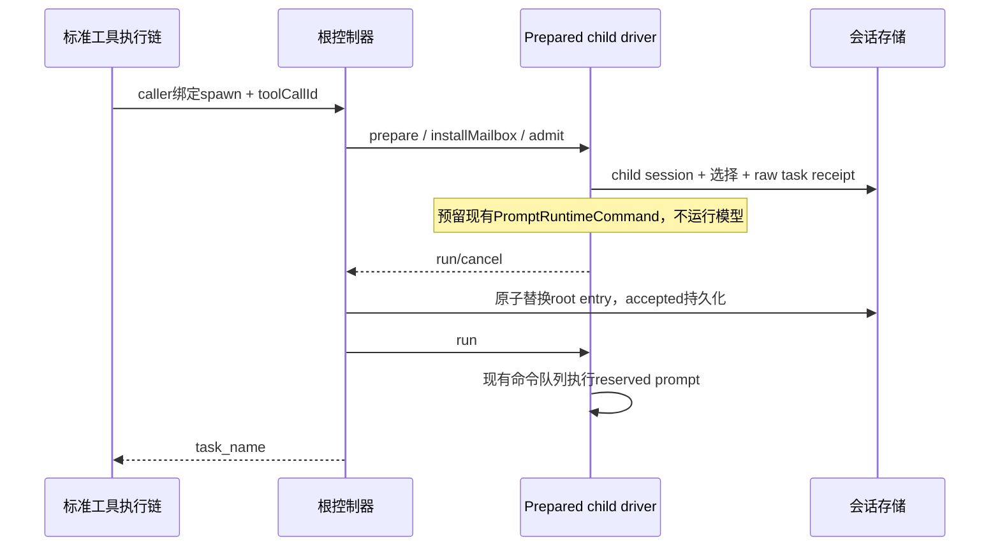

# Task3b：真实运行链合同

控制器版本化 root session-entry 是身份树、accepted 调用、generation 与 mailbox 的唯一持久权威。
宿主 entry 包含固定的归一化协作配置与 controller snapshot；冷启动先校验并读取保存的根身份，
再创建控制器。运行时句柄索引只用于资源寻址，registry、生命周期事件及 ToolPart 身份均为派生投影。
root 首次模型边界只读检查旧 entry：无旧树时仅渲染角色，首次实际协作调用才建树；有旧树时先恢复并
交付邮箱。这不会把普通无协作模型轮变成“必须具有可选 session-entry 写端口”的新要求；一旦实际
创建持久树，缺端口仍明确失败，不静默降级到内存。
普通 UI/selection conversation fork 是新的独立 root。现有 fork bundle 只复制模型选择与明确引用的
verifier entries，不复制 `codex_collaboration` 或 child settings；历史正文仍按已有工具配对规则继承。

## 准入和执行

prepare 复用既有 profile、权限、MCP、skills、memory、AGENTS 与 CUA 装配规则，移除旧 runner、
watchdog、message sink 和 coordinator response owner。accepted 前失败只回收未接受 child；
accepted 后的冷 running 收敛为 interrupted，必须显式 followup，不自动重放任务。
raw task 按 messageId 查重，run 使用 recordedInputMessageId/skipInputRecord 与原 reservation，
不能再插入任务，也不能绕过标准 CommandInbox。取消释放 reservation；没有模型 IO 的 admission
不能调用会立即 drain 的 admitPrompt。

## 模型、历史与消息

all 继承 spawn 时的父选择；none 可用实际目录解析覆盖。agent_type 必须在发布的 profile 快照内，
错误包含请求与可用集合。首次准备把实际 resolved selection 写入 child 模型 entry；后续恢复始终
读取 child 保存的选择，不随父模型切换重算。all 历史复制只包含已闭合的工具调用/结果，剔除当前
未完成 batch 的调用，保留历史正文；不复制活动权限、signal、工具状态或资源句柄。

首次 prepare 同时保存严格版本化 child profile 与注入的 AGENTS 文本；冷恢复读取这些已接受设置，
不随父配置后来删除/修改 profile 而换角色。MCP/skills/CUA 等活动资源仍通过当前宿主受控端口装配，
不保存凭据或句柄。父 runtime 已卸载时，nested child 的新 prepare 明确失败并给出 parent/path，
要求先恢复实际 parent；不得借 root 的历史、模型或权限配置冒充 parent。
child 的工具只能取父当前实际可用工具与 profile 请求工具的交集，再应用父/profile deny。
fork none/all 均不能借显式 profile 恢复父已排除的 Write 等工具。MCP 的 mcp/server selector 只可
展开为父启动快照中实际获准的具体工具名，不能带宽泛 selector 到 child 重新扩大权限；deny 优先。
这里的父边界指可用工具、静态deny与网络等硬限制。默认继承父effective plan；显式profile.permissionMode
继续沿既有模式策略（含guarded对子yolo约束），不能把plan误称为不可覆盖的capability。

prepare 构造 child 后立即将临时资源句柄交给同一 driver；返回端口之前的持久化或冷 hydration 失败也由
controller 的统一 release 清理。prepare 失败的 release 可携带 undefined 端口，driver从已登记资源句柄
找到实际 runtime；成功只关一次，失败保留句柄与controller cleanup记录供重试。原prepare错误与cleanup
错误同时保留，accepted cold history不得discard；constructor登记之前失败则由factory释放已借用浏览器。

六工具创建的执行均为异步。Host 的 `ChildModelExecutionOverride.background: deny` 明确拒绝 spawn
以及会启动 idle/terminal child 的 followup；对 running child 的 followup 只交付消息，不受此拒绝影响。
send/list/wait 不启动执行。允许的执行期选模/请求依赖只通过工具调用的私有上下文进入 prepare，不进入
模型参数、root graph 或持久凭据。child entry 只保存 resolved selection 和“需要执行上下文”标记；
冷恢复若缺少该执行材料或选模不匹配必须失败，不能改用父常驻身份。
已接受 child 的普通 turn 终态封住后台 Bash 通知的自动唤醒；后续 followup 准入时才重开本轮通知。
后台命令仍会结算并更新自己的查询结果，但不能绕过控制器在 idle child 上另起模型轮。

mailbox 的 ACK 只在 raw message 与私有来源持久化成功后返回，重复 messageId 不重复写入。
send 对 idle/root 只排邮箱；followup 才启动 idle child。消息在下一模型/工具边界进入当前请求，
不取消模型或工具。canonical transcript 保存 raw 文本和私有 kind/sender/recipient/path；
provider 唯一出口才把它投影成 assistant 信封。冷 hydration 保留同一来源，不能变成用户授权。
没有旧 inactivity watchdog；权限等待与显式 wait 超过旧期限仍有效。
wait 的活动检查同时读取 controller 尚未交付的邮箱与 driver 已持久 ACK、尚未被模型消费的队列。
driver 只提供同步只读 hasUnreadMessages；不增加消息所有者或轮询。先订阅再检查可避免消息先到、
模型随后调用 wait 时丢失已发生的唤醒。
旧 features.subagent/subagents.enabled 不再控制六工具。内部 script workflow 的隔离由有限的
createCollaborationBinding 宿主注入明确返回 undefined 表达，不创建另一棵树，也不恢复旧模型工具。
旧 features.subagent 从 ConfigKey、值类型、默认值、文件schema与store映射全部删除。features 是有限
开关集合，未知键明确报错；不能把删除的subagent键当未知字段静默strip。ConfigPort的untyped set/get
同样拒绝未知key，merge拒绝旧features字段，不能“保存成功但无行为”。不迁移或修改用户配置文件。

## 展示与关闭

root 的驻留阻塞查询必须读同一 controller 的整树 running 记录与 driver 尚未结算的原 command 句柄，
不能只读直系 child registry。child 的同一查询只读自身子树。interrupt 已提交终态但 command 尚未
结算时仍阻止自动回收；root 派生事件尚在写入时也保持驻留。这些都是既有 owner 的只读查询，不新增
驻留计时器、状态副本或调度路径。

spawn 模型输出只有 task_name。标准 executor 允许记录私有身份到结果 metadata，再由已有 settlement
写入 completed ToolPart；adapter 不直接修改 pending part。崩溃发生在 accepted 与结果落盘之间时，
冷读侧从 root snapshot.accepted + agents 恢复关系，不从 ACK 推断完成。
生命周期沿控制器 committed snapshot 派生，字段为 agentId、childSessionId、parentId、parentSessionId、
path、generation、原始 parentToolCallId、profile 与保存的模型选择。interrupted 显式投影 cancelled。
仅完成 spawn ACK 不代表 child completed。后续 generation 保留原 toolCallId 与同一 childSessionId。

新用户输入唤醒所选 runtime 的 controller wait，不取消 child。普通 Stop 只停所选 session；
原生 UI child stop 调用同一 controller.interrupt，模型 TaskStop 不接受 child。根普通完成不会
关闭 child；宿主 shutdown 必须 await controller.dispose 后才关闭 execution/MCP/session-store。
driver.release 必须先等待该身份已接受 admission.run 的原执行 Promise 实际结算，再关闭浏览器等
资源。abort 事件或 beginShutdown 只发出停止请求，不代表模型/工具已经停止访问共享依赖。
driver 的临时 drain handle 只观察原 run 的成功/失败结算，不存 accepted/status，也不另设超时；
执行错误继续沿原 run 返回 controller 和持久 turn 事件，真实 release 错误继续携带原 cause。
interrupt 的状态提交先于实际执行退出；紧接的 followup 先等待同一原 run 结算，再在同一 childSessionId
预留下一轮，不能用暂时非 idle 报错丢失已接纳的新任务，也不能并行启动两轮。
followup 的旧 command drain 在进入 controller 串行通道之前等待；关闭请求同步封住新的普通 controller
调用，使运行中 command 的后续消息边界及时失败，不能形成 dispose→run→controller tail 的等待环。
显式unload与自动eviction在lane内等待旧command结算时，已中断command在异步投影返回后、
进入controller邮箱lane之前必须检查原准入AbortSignal并退出，不能排到正等待它的release之后。
信号只属于原command资源句柄，不新增状态owner/轮询/timeout，保留cleanupPending和同session followup。
冷恢复终态只重建查询投影，不再次追加完成事件；恢复 running→interrupted 属于实际新转换。
派生事件写失败保留待重放快照，并在 await 边界带上下文失败；成功 append 后才确认投影 receipt。

## 必须实际验证

真实 AgentRuntime + 记录型 store/model 验证无早期 IO、持久输入与幂等、全六工具和空输出、
权限/ToolSearch 链、queue-only/trigger、safe-boundary 信封、冷同会话/模型/身份恢复、损坏历史明确失败、
完整历史工具配对、profile/模型上下文错误、共享深度/容量、steer wait、权限/消息等待不超时、
普通完成/单目标 Stop/全树 shutdown。Controller fake-driver 测试不能替代以上实际运行验收。
