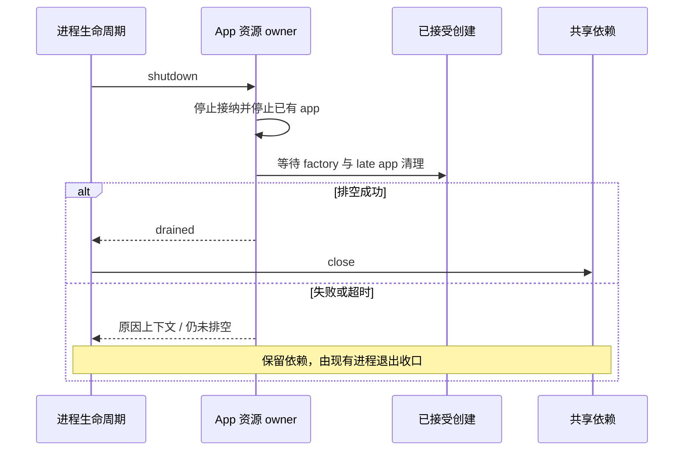

# 协议关闭依赖顺序

## 原因与唯一所有者

`ProtocolRuntimeResources.close()` 原来只等当前 app 集合，遗漏已经接受但 factory 尚未返回的创建。
`cleanupProtocolRuntime()` 原来把最多 400ms 的等待结束当作 app 已停止，随后关闭共享数据库与
MCP 等依赖。因此仍在执行的子会话或晚到 app 可能撞上关闭中的资源。

资源 owner 仍是 `ProtocolRuntimeResources`，进程 deadline 仍由既有 lifecycle 持有。
修复不新增会话队列、模型预算或延迟清理 owner。新逻辑位于 bootstrap 的 managed fork 模块，
原协议文件只做单向导出，降低同步冲突面。

## 接线与错误

- create 同步登记 accepted creation，factory 成功/失败和 late app 清理全部完成后才 settlement。
- close 同步固定已接受集合并禁止新创建；同一个 app 的 stop/close 幂等。普通禁止晚到发布不算清理失败。
- beginShutdown、stopActiveForegroundExecution 和 app close 分别尝试；同时失败保留全部原始原因。
- wrapper 仅在 drain 成功后关闭共享依赖。失败/超时时记录原错误链和保留清单，独立 projection/
  telemetry 继续清理；晚到完成不会启动脱离所有者的依赖清理。

## 实际验证

先补测试，实际复现 5 个失败；完成依赖顺序与 accepted creation 修复后 12/12 通过。
再以同时 begin/stop/close 失败复现旧 finally 覆盖原因，修正后 13/13 通过。
managed 模块单入口导出合同 1/1 通过。Bootstrap 类型检查与所改文件 lint 通过。

规格审查发现普通 app close 失败后被 finally 删除，随后 owner drain 会误报成功。
新增回归实际先红，再只在关闭成功后移除 app；14/14 通过。独立规格与质量审查均批准，
质量审查另以两条独立失败探针验证正在进行的普通 close 及 late app 多重错误。
根 typecheck、lint 与 Bootstrap 类型检查通过。

上述为真实 SQLite 和可控端口的定向测试，不是生产启动包装器或 GUI 的端到端证据。
独立 HTTP 进程会另外验证实际输入恢复与完整清理完成标记，二者不可互相替代。
