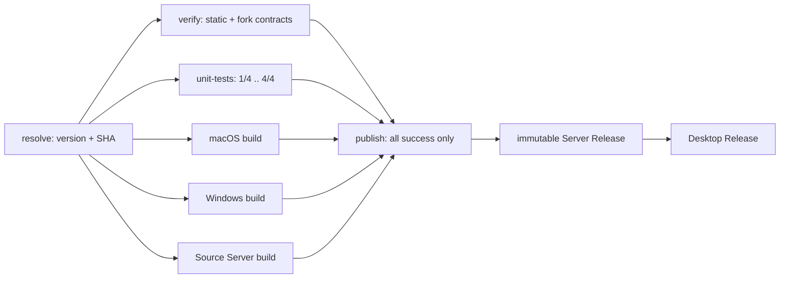
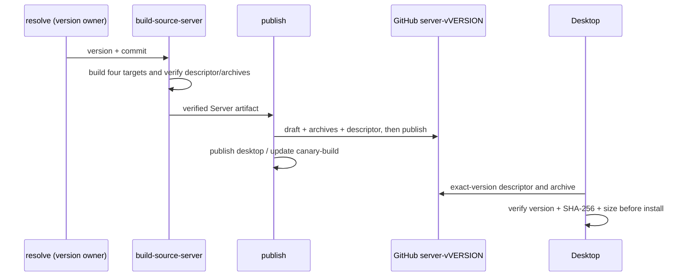

# 桌面端发布流水线

范围：`.github/workflows/release.yml`、`scripts/ci/release-version.mjs` 与 `scripts/ci/source-server-release.mjs`。
覆盖 macOS（arm64）与 Windows（x64）桌面包，以及 Linux/macOS（x64、arm64）配套 Server 的构建与 GitHub Release 发布。

## 通道与触发

| 通道     | 触发条件                              | 版本                                | Release                                               |
| -------- | ------------------------------------- | ----------------------------------- | ----------------------------------------------------- |
| `stable` | 推送 `v*.*.*` tag                     | tag 去掉 `v` 前缀（如 `3.14.3`）    | `v3.14.3`，正式 Release                               |
| `dev`    | 推送到 `canary` 分支，或手动 dispatch | `<根 package.json 版本>-dev.<sha8>` | 固定 tag `canary-build` 的指针发布（不建 dev-<sha8>）；不运行测试，只要求构建成功 |

手动 dispatch 只能选 `dev`；`stable` 必须由 tag 触发，否则流水线在 `resolve` 阶段直接失败，避免出现「人工填版本 + 无 tag」的稳定版本。

## 版本事实源与所有权

- **唯一事实源**：根 `package.json` 的 `version`。桌面端没有任何版本环境变量覆盖入口。
- **消费链**：`packages/desktop/scripts/build-metadata.mjs` 在构建期把版本写入 `out/metadata/build-meta.json`，再分别喂给
  - tsup / vite 的编译期常量 `__ZCODE_VERSION__`（About 面板、遥测、RUM）；
  - electron-builder 的 `extraMetadata.version`（运行时 `app.getVersion()`、产物文件名 `${productName}-${version}-...`）。
- **写入者**：流水线在打包前调用 `scripts/ci/release-version.mjs apply` 改写根 `package.json`。这是唯一允许改写版本的位置，构建阶段只读不写。

接口契约（`scripts/ci/release-version.mjs`）：

- `apply --tag <vX.Y.Z> | --dev-commit <sha> | --version <x.y.z[-pre]>`：改写根 `package.json`，stdout 输出 `version=<v>` 与 `channel=stable|dev`，人类可读日志走 stderr；非法 semver（含 `+`）或非法 SHA 直接非零退出。
- `verify --expect <v> --asar <app.asar> [--expect-commit <full-sha>]`：校验产物内 `package.json#version`、`out/metadata/build-meta.json#appVersion`，以及短 SHA `buildCommitId` 与期望提交的前缀一致。

## 作业门禁与跳过语义

- `verify`（typecheck / lint / architecture / fork-removals / CLI 构建 / fork 契约）与 `unit-tests`（完整 Vitest 集合的四个分片）只在正式 tag 通道运行。canary 是快速集成构建，不运行测试，也不把静态门禁作为发布前置。
- 正式发布的完整门禁范围不缩减；canary 产物不是稳定版本，不能以构建成功替代 tag 发布的测试放行。
- **无 `if` 的作业隐式条件是 `success()`，它要求依赖图上「所有祖先作业」成功——被跳过的祖先会让下游被判成 skip。** 这不是「只要求直接 `needs` 成功」。实测踩到过：`verify` 按预期 skipped、两个平台构建都 success，但 `publish` 因为没有显式条件而被跳过，dev 包没发出来（run 36521516436）。
- 因此凡是 `needs` 链上可能出现 skipped 的作业都必须显式写条件。当前判定如下：

| 渠道                   | `verify` / `unit-tests` | 桌面与 Server 构建     | `publish`                                      |
| ---------------------- | ----------------------- | ---------------------- | ---------------------------------------------- |
| dev（推送 canary）     | `if` 条件跳过           | resolve 成功后并行运行 | 三类构建成功即运行，忽略跳过的测试             |
| tag 且门禁通过         | 必须全部成功            | resolve 成功后并行运行 | 两类门禁与三类构建全部成功才运行               |
| 任一正式门禁失败/跳过  | 非 success              | 可已完成或仍在运行     | 不创建 Server 或 Desktop Release               |
| canary 任一构建失败    | skipped                 | 可为 success/failure   | 不更新 `canary-build` 指针                     |

- 新增作业时照抄这条规则：**只要它 `needs` 的链上可能有 skipped 作业，就必须写显式条件**（用 `!cancelled()` 而非 `always()`，后者在被取消时也会继续跑）。
- `verify` 里在单测前会按依赖链构建 CLI 包（`pnpm -r --filter "@zcode/core..."`）：`apps/zcode-cli/packages/core/test` 的测试 import 上游 tool 入口，而这些包的 `exports` 指向 `dist`，verify 只 install 不 build 会 `ERR_MODULE_NOT_FOUND` 让整组失败。

## 构建环境契约

- `ZCODE_ENV=production`：builtin provider 配置与产品身份都按 production 解析。缺失或为 `test` 时 `desktop-product-identity.mjs` 会回落到 Preview 身份，产物变成 “ZCode Preview” 且文件名带 `_TEST` 后缀。
- Windows job 带 `ZCODE_SKIP_REMOTE_ASSETS=1`：Windows 安装包不依赖 mock-cdn remote 资产（`packages/desktop/scripts/prepare-runtime-assets.mjs:56`）。
- `ZCODE_DESKTOP_DIST_DIR=dist-<os>-<arch>`：按平台隔离 electron-builder 输出目录，避免多架构共享 checkout 时互相覆盖。
- macOS 只发布 arm64 包。若要发布 Intel 包，必须在 Intel runner（`macos-15-intel`）上构建：node-pty 在非 Windows 宿主按宿主架构 `electron-rebuild`，且运行时优先加载 `build/Release/pty.node`，在 arm64 宿主上打 x64 包会混入 arm64 原生模块。
- 首次发布前需在组织/仓库 Secrets 配置（可选）：`MAC_CSC_LINK`、`MAC_CSC_KEY_PASSWORD`、`MAC_SIGNING_IDENTITY`。三个变量同时存在时流水线设置 `ZCODE_ENABLE_MAC_SIGN=1` 并注入 electron-builder 证书变量；缺省则产出未签名包。

## 验收场景

1. **tag 版本进入程序**：`verify` 步骤比对 app.asar 内 `package.json#version` 与 `build-meta.json#appVersion` 等于 tag 版本，且 `buildCommitId` 为该 tag 提交的短 SHA。产物文件名同时包含该版本号（`ZCode-<version>-mac-arm64.dmg` 等），上传步骤使用 `if-no-files-found: error`。
2. **dev 通道不污染稳定通道**：dev 只更新 `canary-build` 指针发布，且以 `--prerelease --latest=false` 更新，`releases/latest` 仍指向稳定版本；dev 不再产生 dev-<sha8> 发布。
3. **半套产物不发布**：`publish` 直接依赖 `resolve`、`verify`、`unit-tests` 和所有构建。canary 只要求三类构建成功；正式 tag 还必须 `verify` 与 `unit-tests` 全部 `success`。任一门禁/分片/构建失败、跳过或取消时，即使已上传 Actions artifact，也不得创建 Release。
4. **重复执行幂等**：同一 tag 或同一提交重跑时，先 `gh release edit` 再回退 `create`，资源用 `--clobber` 覆盖。
5. **dev 通道只产出指针发布**：dev 集成不建 dev-<sha8> 发布，包只更新到 `canary-build`；指针上的资产每次只保留本次集成的一套（先上传本次资产、再删掉不属于本次的文件），因此 Releases 里始终只有一份 dev 包。
   - **指针发布 `canary-build` 只保留本次集成的资产**：资产名带版本号（`ZCode-<version>-<platform>-<arch>`），`gh release upload --clobber` 只覆盖同名文件，所以 publish 在「先上传本次资产、再删掉不属于本次的文件」。不清理时实测堆到 18 个资产 / 3 个版本（`dev.yml` / `dev-mac.yml` / `SHA256SUMS.txt` 名字固定，靠 `--clobber` 覆盖）。

## 边界与已知缺口

- **公证未实现**：仓库刻意关闭 electron-builder 内置公证（`notarize: false`），公证属于独立阶段，本流水线不做；macOS 产物默认未签名、未公证，用户首次打开需手动放行；发布说明里给出 `xattr -cr /Applications/ZCode.app`（清除 quarantine）作为「提示已损坏 / 仍打不开」时的兜底。
- **嵌套运行时未预签名**：`Contents/Resources/glm`、`tools` 与 CUA Helper 在原流水线中由独立 job 完成 Developer ID 签名与 staple，本流水线不涉及。因此仅打开签名开关只覆盖主 app，不构成可公证的完整签名链。
- **发布架构范围**：macOS 仅 arm64，Windows 仅 x64（未发布 win32-arm64、mac x64）。
- **第三方清单**：`third-party/inventory.json` 记录的 `package.json` 哈希与当前文件不一致（需执行 `node scripts/licenses.mjs notices` 重新生成），因此 `licenses.mjs check --strict` 在流水线中仅作提示（`continue-on-error: true`），不阻塞发布；打包链路本身不校验清单新鲜度。
- **清理流水线不得触碰有效下载入口**：`.github/workflows/cleanup-prerelease-tags.yml`（每日 03:00 + 手动）的悬空判定依赖 `git tag --list 'v*'`。必须保留 `canary-build` 指针与 `server-v*` 配套运行时发布；遗留 `dev-*` 发布不再保留。
- **已跳过作业的流水线「成功」具有误导性**：`publish` 被跳过时整个 run 仍显示 success（被跳过的作业不算失败）。发布是否真的发生，要看 run 里 `publish` 的结论，不能只看 run 的总体状态。

## 2026-10-24 同步验证

2026-11-03 用户调整通道策略：canary 集成只要求构建成功，允许跳过 verify 与 unit-tests；正式 tag 仍必须执行完整静态门禁和两种测试入口，跳过不能作为正式发布验证。此前“canary 也必须执行完整门禁”的规则已被本节取代。

## 2026-11-03 发布关键路径优化（二开基础设施）

背景：实测 run 41413444449 共 30m13s，其中 verify 14m42s、Windows 14m32s；
单测耗时约 11–16 分钟。原依赖图把这两段串行相加；bundle 又先 prepare 再调用包含 prepare 的 build。

- **版本唯一所有者仍是 resolve**。所有作业使用同一 workflow SHA 的独立 checkout，消费同一版本/提交输出。
- **发布唯一写入者仍是 publish**。构建允许推测执行，仅上传 Actions artifact，不创建 Release。
  正式 tag 汇合完整门禁和三类构建；canary 只汇合三类构建。发布仍先发布不可变 Server，再发布桌面。
- `unit-tests` 使用 Vitest 官方 `--shard=<index>/4`，四个独立 Ubuntu runner 完整覆盖根配置的所有项目，
  不另维护测试文件列表，不改变 include/exclude、worker 数、超时或测试断言。
  `engineering` / `fork-contracts` 在每个分片内仍是单 worker 串行；跨 runner 没有共享进程树/cwd/文件状态。
  matrix `fail-fast: false` 保留其余分片的诊断结果，每片先构建所需 CLI 包并补装 Electron。
- 本地 `pnpm test:unit` 保持原入口。fork 的 node:test 契约仍完整执行一次，不被 Vitest 分片替代。
- `bundle.mjs` 独占 bundle 路径的 runtime prepare 调度，随后调用 `build:no-runtime-assets`。
  直接 `pnpm --filter @zcode/desktop build` 仍自带 prepare；`--skip-prepare` 和 `--skip-build` 独立生效，
  默认 prepare 一次，skip-prepare 不得被嵌套 build 偷偷重新执行。打包后校验、签名及产物种类不变。
- 同 ref 串行与 `cancel-in-progress: false` 不变，避免中断正在发布的半套资源。
  不通过缓存未验证的测试结果、移除隔离或跳过门禁换取速度；暂不合并 ASAR 后处理，避免扩大签名/原生包验证范围。

上图为正式 tag 路径；canary 路径跳过 `V` 与 `T`，只要求 `M/W/S` 成功。

验收：依赖图契约遍历每个直接门禁的 failure/skipped/cancelled，均阻止 publish；所有成功才允许发布；
四个 Vitest 分片发现集合不重不漏且与未分片集合相等；隔离项目原并发限制不变；
bundle 默认/两个 skip 标志的四种组合均无重复 prepare；实际 manifest 保证 no-runtime-assets 只构建 metadata 与 app。
预计端到端目标 12–16 分钟（无排队、runner 资源充足），不是本地验证结论；需推送后采集至少 2–3 轮实测。
并行会增加失败提交的 runner 消耗，账号并发额度与网络波动可能降低收益。

### 独立单测分片的构建前置条件

run [41560008767](https://github.com/Rain-kl/ZCode/actions/runs/41560008767) 的三个分片在加载
E2E reporting 单测时无法解析 `@zcode/e2e-report`。该包公开入口指向 `dist-node/node/index.js`，
独立 runner 只有源码；verify 中的 typecheck 和其他构建作业生成的文件不会共享给单测分片。

- 每个 `unit-tests` runner 必须在运行 Vitest 前执行 `pnpm --filter @zcode/e2e-report build:node`，
  和 CLI 包构建、Electron 补装一起作为显式前置条件。只构建 Node 公共入口，不要求构建报告 Viewer。
- 验收：workflow 契约验证构建命令存在且先于单测；在空输出目录构建并加载包公开入口，
  并执行 lifecycle、error classification、skipped summary 三个实际 reporting 回归。
- 同一 run 还发现 App/分享只读渲染一致性测试仍使用已移除的 `Agent` 输入。
  测试必须改用现有 `spawn_agent` 参数，继续断言两端摘要一致；不恢复旧工具或展示兼容。

## 2026-11-03 CI run 41575790953 修复

本次 canary 发布在四个独立点失败，已分别修复：

- Vitest 分片契约跟随当前显式项目 `engineering` / `fork-contracts` / `cua-placeholder`，继续断言官方四片覆盖全部 209 个项目/文件且无重复，不恢复已退役的 App 业务测试发现。
- Windows 工程契约与产品策略对齐：关闭 Inspector 参数、保留 RunAsNode，并明确禁止签名验证形成更新门槛。
- 预编译 tgz 解压先以调用方 cwd 解析归档和目标，再从归档父目录执行 tar，`-f` 只收到 `./<basename>`。Windows 跨盘归档不再把 `D:` 传给 GNU tar 识别为远程主机；不增加 GNU 专属参数。
- Source Server 安装复用其他 job 的三次有界重试，只重试 ENOENT/网络类临时错误；锁文件配置错误立即失败，最终状态和诊断仍保留。

验证边界：release/sharding/Source Server 契约 23 通过，Electron builder 安全 15 通过，相关 bundled npm/feed 17 通过，预编译解压 8 通过；node:test 7 组通过，包含 unsigned Windows/feed 依赖合同。真实 Windows 跨盘打包与新的 Linux hosted install 需要在后续 CI run 验证；本次本地为 macOS。

## 2026-11-02 配套 Source Server 发布

背景：`3.17.162-dev.084c4811` 桌面包仍向上游 CDN 请求同版本的
`source-server-release.json`，两个默认源均返回 404/NoSuchKey。现有 workflow 只上传桌面包，
不包含 Server 清单与归档；SSH 探测成功后因此无法安装。这是发布资源缺失，不是 SSH 鉴权失败。

- `resolve` 仍是唯一版本所有者。独立 `build-source-server` 作业消费同一 version/commit，复用
  `pnpm prepare:remote-assets`，构建 linux-x64、linux-arm64、darwin-x64、darwin-arm64 完整归档。
  归档已含 Node、Server、Agent、插件和工具，首次安装与整包升级不依赖额外 CDN 组件。
- CI 验证清单版本、四目标集合、文件名、字节数、SHA-256，以及归档内 manifest 的版本/目标；
  缺失、损坏或版本混用必须阻止发布。发布 job 下载桌面和 Server 到不同目录，防止混入指针清理范围。
- GitHub Server Release tag 为 `server-v<完整版本>`，始终 prerelease、`latest=false`；
  不使用 `canary-build` 或 latest 别名。canary 的完整版本含 sha8，后续 canary 发布不覆盖旧版本。
  这是配套运行时的版本保留，不恢复历史 `dev-<sha>` 桌面发布。
- 新 Server Release 先创建 draft、上传归档，最后上传清单并公开；桌面 Release 在 Server 可用后才发布。
  已公开版本重跑构建作业时先下载并校验原包，避免 tar 时间戳导致重建字节不同。
  已公开且内容相同的 Server Release 重跑只校验、不覆盖；同版本内容变化明确失败，禁止替换旧客户端的依赖。
  Server Release 独立保留，cleanup 不得将 `server-v*` 判为 dangling 删除。
- Desktop 默认通过本仓库 GitHub 对应 Server Release 拉取清单与归档；GitHub release 基址不可再拼版本目录。
  显式下载源覆盖与测试产品环境继续保留，未打包开发态继续使用本地产物和内容寻址策略。
- 下载失败在原始 cause 中携带具体 URL、HTTP 状态或解析/网络错误；用户可见信息沿用连接日志的
  URL 脱敏策略，但仍保留 HTTP 状态和具体失败原因，不仅显示笼统的 descriptor 错误。
- 本次不改 SSH、远端安装器、协议、owner/lease 或业务队列，不部署或重启用户远程设备。

验收：stable/dev 都要求 Server 构建成功；任一目标缺失则桌面不发布；连续两次 canary 发布后旧客户端
仍能使用旧的 Server URL；重跑相同内容无副作用、同版本不同内容失败；cleanup 保留 Server 发布；
清单 404、无效 JSON 和版本不符时错误保留请求上下文。真实 GitHub 发布与远程 SSH 安装未执行前不得宣称验收通过。
