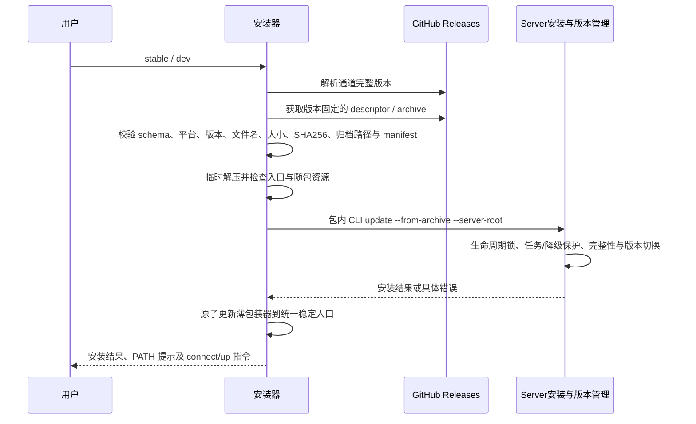

# Server 一键安装合同

## 范围与接口

提供独立 `scripts/install-server.sh`，通过 `curl -fsSL https://raw.githubusercontent.com/Rain-kl/ZCode/canary/scripts/install-server.sh | sh` 安装 Source Server；`sh -s -- dev` 选择开发版，无参数选择正式版，其他参数报错。支持 Linux/macOS x64/arm64，需要 curl、Python 3（3.8+）；使用发行包自带 Node，不安装系统包、不使用 sudo、不启动服务、不写连接凭据。

正式版读取 GitHub `/repos/Rain-kl/ZCode/releases/latest` 的稳定 `v<version>`，并从不可变的 `server-v<version>` 下载；开发版直接读取固定 `server-canary-build` 的 descriptor，以 descriptor 声明的完整 dev 版本安装，不等待 Desktop canary。两种通道都必须校验 descriptor 版本、目标、大小与 SHA-256。不得用发布时间排序选择 Server，也不得在正式版缺包时回退开发版。

2026-11-03 统一安装：curl 与 SSH 都由既有 Server `update --from-archive` / ReleaseInstaller / ReleaseManager 维护安装。统一根为 `~/.zcode/server`，运行包在 `releases/<version>-<target>-<sha前12位>`，当前版本由 `current.json` 指定，稳定入口为 `bin/zcode`。安装脚本不得自行写 releases、current/pending、完整性或安装所有权文件。通过 `ZCODE_DATA_BASE_DIR` 改变基目录时同样拼接 `.zcode/server`；旧 `ZCODE_SERVER_INSTALL_DIR` 明确报错并提示新设置，不继续创建独立版本树。

`~/.local/bin/zcode`（允许 `ZCODE_SERVER_BIN_DIR` 覆盖）只放原子发布的薄包装器，执行统一稳定入口并默认传入对应 `--server-root`；用户显式指定 root 时尊重其选择。不能将符号链接直接指到依赖 `$0` 定位的稳定 launcher。只覆盖本脚本标记的包装器、同根稳定入口链接，或上一版脚本创建且标记匹配的 `.installer-launcher` 链接。旧 `.local/share/zcode-server` 运行包不删除、不搬迁、不当作当前版本；安装成功后接管旧命令，配置和会话已经属于统一数据根，无需复制。

CLI 必须先解析并移除全局 `--server-root`，再归一化 server 子命令；单独 `zcode server --server-root <root>` 仍是帮助，root 位于命令前后均命中同一分发流程，不能把全局参数当作子命令。

安装与更新沿用 SSH 的生命周期锁、运行任务保护、降级确认及幂等完整性规则。固定 canary 包是 `dev` 安装的权威版本，允许其覆盖 commit hash 排序更低的开发版本；稳定版仍要求降级确认。所有安装都不使用 `--force`；busy 时拒绝并保持当前版本，空闲运行中的实例由现有更新流程协调重启，无实例时只安装、不启动。未知错误保留具体命令、退出码及 stderr。脚本只有 Server 安装成功才切换 PATH 入口。

资源统一：所有 Source Server 归档和 agent-runtime 组件必须包含与 Agent bundle 同次构建的 `runtime/provider/zcode-builtin.json`；缺失时 staging 失败。该文件进入既有组件哈希与归档，不在安装时从仓库拉取零散配置，不改用户 provider 配置。`zcode server connect/logout/up/down/logs` 为本发行包的远控命令；不增加通用 `--web` 模式。

## 安装顺序与失败边界

网络错误包含 URL 与 curl 原因，descriptor/校验/解压/权限失败非零退出；完成验证前不替换命令，不删除旧版本。拒绝目录穿越、越界软/硬链接和特殊设备文件；包内 manifest 必须匹配 product/appVersion/target，必须包含 bin/zcode、runtime/node、runtime/server-cli.js 与 provider 配置。验证后执行包内安装命令，使用随包 Node。

脚本 URL 在 canary 分支发布后才可用；本地提交不代表公共地址已更新。当前最新稳定桌面版没有 Server companion 时，默认安装明确失败，待正式发布包含 Server 后自然可用。

## 验收

- 默认稳定、dev 通道及四个平台映射正确；不支持平台与未知参数在下载前失败。
- 在隔离 HOME、模拟 curl 和实际 tar.gz 夹具中验证安装与命令参数转发。
- 非法 descriptor、错误大小/SHA、manifest 不符、路径越界和下载失败都保留旧命令。
- 重复安装与升级安全，非本安装器命令不覆盖，带空格路径正确。
- curl 委派同一 Server 安装命令，不另写 current.json；模拟安装端拒绝时保留旧命令。另用真实发行包验证统一 root/current/stable launcher，不以模拟端代替真实版本管理证据。
- 旧安装器入口迁移后指向同一稳定 launcher，原始目录和会话哨兵保留；SSH 后续更新 current 时 PATH 入口无需重装即可跟随。
- staging 缺少 provider 资源失败；文件进入 agent-runtime 的 paths、哈希和组件归档。
- README 给出稳定/dev 安装、依赖、PATH、连接及启动方式。
- 必要门禁：安装器回归、发布回归、`sh -n`、`pnpm typecheck`、`pnpm lint`、架构检查。
