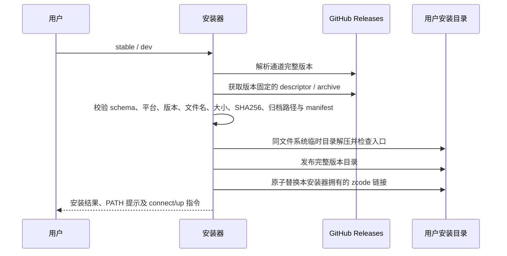

# Server 一键安装合同

## 范围与接口

提供独立 `scripts/install-server.sh`，通过 `curl -fsSL https://raw.githubusercontent.com/Rain-kl/ZCode/canary/scripts/install-server.sh | sh` 安装 Source Server；`sh -s -- dev` 选择开发版，无参数选择正式版，其他参数报错。支持 Linux/macOS x64/arm64，需要 curl、Python 3（3.8+）；使用发行包自带 Node，不安装系统包、不使用 sudo、不启动服务、不写连接凭据。

正式版读取 GitHub `/repos/Rain-kl/ZCode/releases/latest` 的稳定 `v<version>`；开发版读取 `canary-build/dev.yml` 顶层 version。两者均固定到不可变的 `server-v<完整版本>`，下载 `source-server-release.json` 与当前平台归档。不得用发布时间排序选择 Server，也不得在正式版缺包时回退开发版。

安装器是运行文件的唯一写入者；不改 Server 自身的配置、项目、会话与生命周期状态。默认运行文件为 `~/.local/share/zcode-server/releases/<version>-<target>-<sha256>/`，命令为 `~/.local/bin/zcode`。允许用绝对路径 `ZCODE_SERVER_INSTALL_DIR`、`ZCODE_SERVER_BIN_DIR` 覆盖。已存在的非本脚本命令拒绝覆盖；已安装内容相同则复用；更新只原子替换本脚本所有的命令符号链接。保留旧版本和运行中的服务，提示升级前 down、升级后 up。

## 安装顺序与失败边界

网络错误包含 URL 与 curl 原因，descriptor/校验/解压/权限失败非零退出；完成验证前不替换命令，不删除旧版本。拒绝目录穿越、越界软/硬链接和特殊设备文件；包内 manifest 必须匹配 product/appVersion/target，必须包含 bin/zcode、runtime/node、runtime/server-cli.js。安装不执行包内程序。

脚本 URL 在 canary 分支发布后才可用；本地提交不代表公共地址已更新。当前最新稳定桌面版没有 Server companion 时，默认安装明确失败，待正式发布包含 Server 后自然可用。

## 验收

- 默认稳定、dev 通道及四个平台映射正确；不支持平台与未知参数在下载前失败。
- 在隔离 HOME、模拟 curl 和实际 tar.gz 夹具中验证安装与命令参数转发。
- 非法 descriptor、错误大小/SHA、manifest 不符、路径越界和下载失败都保留旧命令。
- 重复安装与升级安全，非本安装器命令不覆盖，带空格路径正确。
- README 给出稳定/dev 安装、依赖、PATH、连接及启动方式。
- 必要门禁：安装器回归、发布回归、`sh -n`、`pnpm typecheck`、`pnpm lint`、架构检查。
